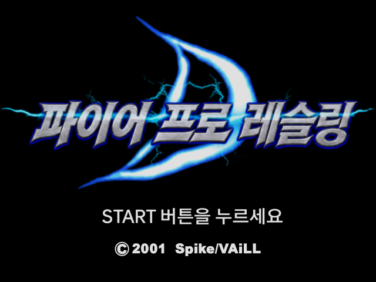
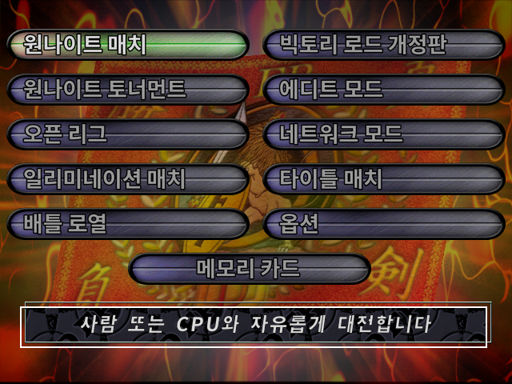
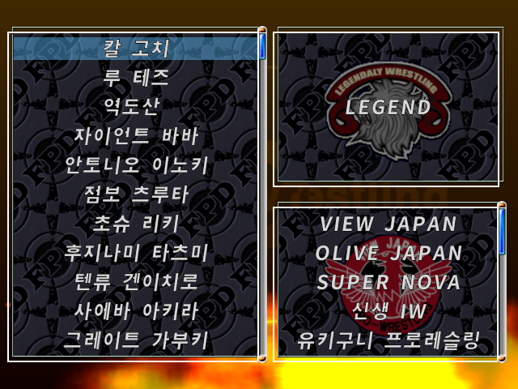
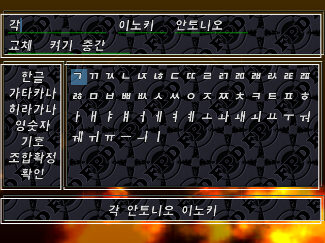
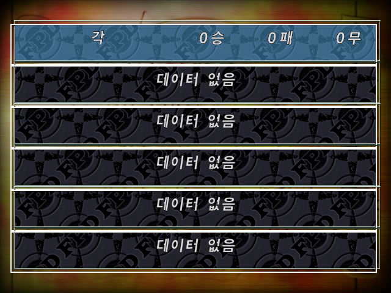
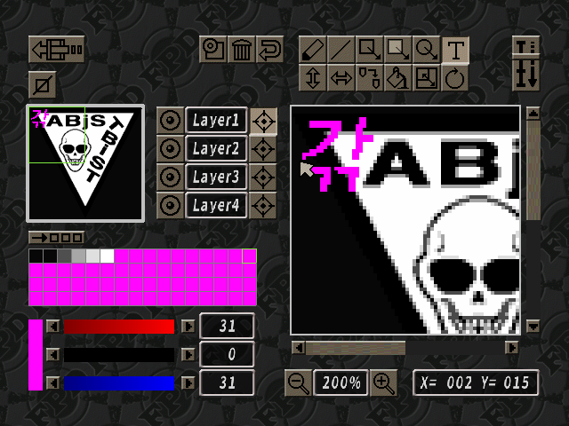
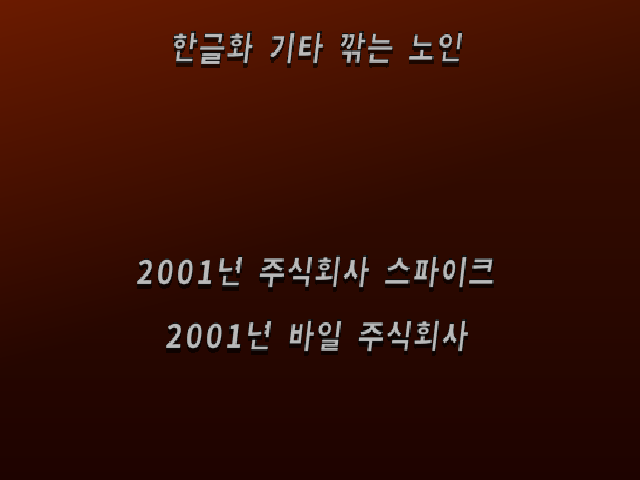
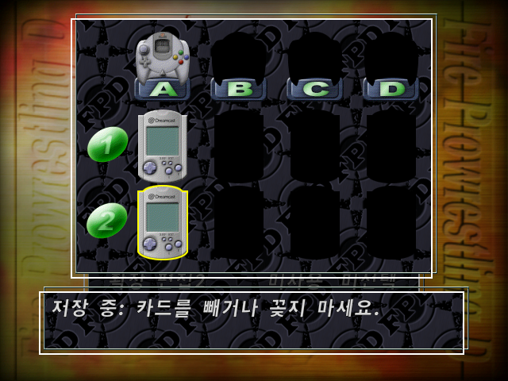

# DC-Fire-Pro-Wrestling-D-Kr · v0.9

**드림캐스트 파이어 프로 레슬링 D 일본판 한글 패치 · 한글화: 기타 깎는 노인**

v0.9 개발판입니다. 원본을 선택해 적용하는 Windows 10/11 x64 EXE 패처를 제공합니다. 게임 원본이나 BIOS는 포함하지 않습니다.

## 다운로드와 적용

[**v0.9 릴리스 / EXE 다운로드**](https://github.com/OldManCraveGuitars-bit/DC-Fire-Pro-Wrestling-D-Kr/releases/tag/v0.9)

1. `FireProD-Kr-v0.9-Patcher.exe`를 실행합니다. Python 별도 설치는 필요하지 않습니다.
2. 아래 해시의 일본판 원본 CHD 또는 원본 50트랙 GDI를 고릅니다. GDI라면 트랙 파일도 같은 폴더에 있어야 합니다.
3. 새 출력 폴더를 지정하고 적용합니다. 약 5GB의 여유 공간을 준비하세요.
4. 결과 `FireProD-KR-v0.9.gdi`와 **트랙 50개를 함께** 사용합니다. 이전 에뮬레이터 세이브스테이트 대신 새로 부팅하세요.

원본은 읽기만 하며 기존 출력 폴더에는 덮어쓰지 않습니다. 원본 해시가 다르면 적용을 중단하고, 완료 전 결과 50트랙 해시를 모두 대조합니다. 압축 방식이 다른 CHD는 같은 게임이어도 컨테이너 해시가 다를 수 있습니다. 그런 경우 원본 GDI로 추출한 뒤 트랙 해시가 일치해야 적용됩니다.

## SHA-256

| 대상 | 크기(bytes) | SHA-256 |
|---|---|---|
| 일본판 원본 CHD | 689500532 | e111b7fcbeb8ad1089e4d37544dd3255b3d45cea7b959837ca1ecaf1b51b0379 |
| 배포 EXE | 18308829 | 169272ca986f2bab9444ed7c99ca9130f59d414157a0b34bede588e08ed8b475 |
| 적용 후 original03.bin | 104254752 | 18f3fdcf658412a202cc87cdc4a7b0d1fc4c18194b7ba1fdef6ae8244e5c3405 |
| 적용 후 original50.bin | 111480096 | a44345b7517a21dd35ae633a817a83e9e31353488015f0ec9a904ec502ac4c07 |

GDI 설명 파일 자체는 원본과 같을 수 있습니다. 결과 판별에는 변경 트랙 03·50과 [전체 트랙 해시](docs/TRACK_HASHES.md)를 사용하세요. 배포 파일 전체 해시는 릴리스의 `SHA256SUMS.txt`와 `hashes.json`에 제공합니다.

## 적용 내용과 추가 요소

| 항목 | v0.9 적용 내용 | 범위/주의 |
|---|---|---|
| 한글화 | 타이틀·시작 안내·주요 메뉴·기술·프로필·제작진 | 일부 이미지·의상·브라우저 그림은 일본어가 남습니다. |
| 본문 글꼴 | 24px 본문, 공통 기준선, 반각 띄어쓰기 | 이름마다 글꼴 크기를 바꾸지 않습니다. |
| 한글 입력 | 현대 한글 11,172음절·자모 51자, ㄱ+ㅏ+ㄱ → 각 | 선수명·단체/팀명·대전 기록·로고 글자 입력. 원래 저장 필드 용량은 유지합니다. |
| 입력 삭제 | 각 → 가 → ㄱ → 빈칸 | 겹모음·겹받침 조합과 삭제를 지원합니다. |
| 숨김 콘텐츠 | 추가 팀·제작진·편집 300점·추가 색상 해금 | 진행 단계 조회를 해금 상태로 처리합니다. |
| 공식 다운로드 기술 | W00~W56, 57개 | 게임 데이터에 내장합니다. |
| 커뮤니티 기술 | W57~W99, Z 이식 43개 | 공식 DLC와 구분해 목록에 기록합니다. |
| 추가 선수 | Spike 1·2·6·7·9·10·12 팩 활성 46명 | 확장 데이터 4, 기존 카드 E04가 우선합니다. |
| 본편 선수명 | 187명 실제 링네임 적용 | 격투가·슈트 계열 33명은 이번 실명 교정 대상에서 제외합니다. |
| 추가 선수명 | 36명 이름 교정 | 실존 34명·VF 게스트 1명·원작 마스코트 1명, 나머지 10명 기존 표기 유지. |
| 단체 이적 지연 | 반복 이동 108 → 5~9프레임 | 같은 목록/전용 에뮬레이터 측정. 추가 메모리 없이 개선합니다. |
| UI 넘침 | 저장·불러오기 등 긴 안내 여섯 곳 축약 | 512px 창의 오른쪽 여백을 남기고 기존 글자 크기를 유지합니다. |
| 제작진 | 담당 항목·인명·회사명 한글화, 한글화 기타 깎는 노인 표기 | 인명 18명은 독음 잠정 표기입니다. |
| 출력 형식 | 원본 50트랙 GDI 구조·47개 오디오 보존 | 실물 드림캐스트 실행 검증은 미완료입니다. |

## DLC 상세 표

공식 57개와 커뮤니티 43개, 추가 선수 46명의 이름·소속·별명·필살기를 모두 기록했습니다. **게임 화면에는 공식/이식 출처 표식이 없습니다.**

공식·이식 기술 100개 및 추가 선수 46명 전체 표 펼치기

# 내장 DLC와 추가 콘텐츠 전체 표

공식 기술 57개 + 커뮤니티 이식 기술 43개 + 추가 선수 46명입니다. W 번호는 내부 저장 슬롯이며 화면의 표시 순서나 출처 표식이 아닙니다. 현재 게임 화면에 공식/이식 구분 표시는 없고, W05와 W79는 모두 샤이닝 위저드입니다.

## 공식 다운로드 기술 57개

| 슬롯 | 현재 한글 기술명 | 원본 기술명 |
|---|---|---|
| W00 | 블레이징 토네이도 | ブレイジングトルネード |
| W01 | 에펠 드 파라슈트 | エッフェル・ド・パラシュート |
| W02 | 데들리 고 라운드 | デッドリー・ゴーラウンド |
| W03 | 머슬 버스터 | マッスル・バスター |
| W04 | 시라누이 | Ｓｈｉｒａｎｕｉ　（Ｓｅａ　Ｆｉｒｅ） |
| W05 | 샤이닝 위저드 | シャイニングウィザード |
| W06 | 웜 | ワーム |
| W07 | 보디 시저스 프런트 넥록 | 胴絞めフロントネックロック |
| W08 | 버펄로 슬리퍼 | バッファロースリーパー |
| W09 | 라스트 라이드 | ラストライド |
| W10 | 카마모토 난무 | 鎌本乱舞 |
| W11 | 스트라이크 스리 | ストライクスリー |
| W12 | 브라질리언 킥 러시 | ブラジリアンキックラッシュ |
| W13 | 내가 사가미다 | オレが相模 |
| W14 | 피닉스 킥 | フェニックスキック |
| W15 | 론다트 캥거루 킥 | ロンダートカンガルーキック |
| W16 | 사이드 저먼 수플렉스 | 横抱え式ジャーマンスープレックス |
| W17 | 고속 드래곤 스크루 | 高速ドラゴンスクリュー |
| W18 | 터보 드롭 II | ターボ・ドロップＩＩ |
| W19 | 슈퍼 킥 | スーパー・キック |
| W20 | 어메이즈 임팩트 | アメイズインパクト |
| W21 | 뒤통수 니킥 | 後頭部膝蹴り |
| W22 | 코브라 홀드 | コブラホールド |
| W23 | 트리플 문설트 프레스 | トリプルムーンサルトプレス |
| W24 | 캐틀 뮤틸레이션 | キャトルミューティレイション |
| W25 | 톱로프 타이거 드라이버 | 雪崩式タイガードライバー |
| W26 | 암 트랩 레그 스위프 | Ｌｅｇ　Ｓｗｅｅｐ　ｗ／ａｒｍ |
| W27 | 블레이징 찹 | ブレイジングチョップ |
| W28 | 프런트 헤드록 | Ｆｒｏｎｔ　Ｈｅａｄｌｏｃｋ　 |
| W29 | 코너 샤이닝 위저드 | 串刺し式シャイニングウィザード |
| W30 | 앵클 홀드 | アンクルホールド |
| W31 | 미츠루 스페셜 II | ミツルスペシャルＩＩ |
| W32 | 데드 엔드 | デッドエンド |
| W33 | 컴플리트 샷 | コンプリートショット |
| W34 | 어깨 태우기 페이스버스터 | 肩車フェイスバスター |
| W35 | 파이널 앤서? | ファイナルアンサー？ |
| W36 | 리버스 수차 드롭 | リバース水車落とし |
| W37 | 사이클링 야호 | サイクリング・ヤッホー |
| W38 | 스카이 하이 초크슬램 | スカイハイ・チョークスラム |
| W39 | 샤이닝 켄카 킥 | シャイニングケンカキック |
| W40 | 펜듈럼 다이아몬드 커터 | 振り子式ダイヤモンドカッター |
| W41 | 슈바인 | シュバイン |
| W42 | 쿠아 러시 | クアラッシュ |
| W43 | 시저스 킥 | シザースキック |
| W44 | 하이퍼 니 쿠가 | ハイパー二ー空牙 |
| W45 | 넥록 암록 | 首極めアームロック |
| W46 | 정수리 니킥 | 脳天膝蹴り |
| W47 | 토털 일리미네이션 | トータル・イリミネーション |
| W48 | 스트레치 머플러 | Ｓｔｒｅｔｃｈ　Ｍｕｆｆｌｅｒ |
| W49 | 요코스카 커터 | 横須賀カッター |
| W50 | 키지 MAX 홀드 | キジＭＡＸホールド |
| W51 | 자이언트 프레스 | Ｇｉａｎｔ　Ｐｒｅｓｓ |
| W52 | 크레이지 사이클론 | クレイジーサイクロン |
| W53 | 타란툴라 | Ｔａｒａｎｔｕｌａ |
| W54 | 바나나 스프레드 | バナナスプレッド |
| W55 | 골든 레프트 | ゴールデンレフト |
| W56 | 문설트 풋스탬프 | ムーンサルトフットスタンプ |

## 커뮤니티 Z 이식 기술 43개

| 슬롯 | 현재 한글 기술명 | 원본 기술명 |
|---|---|---|
| W57 | 대회전 DDT | 大旋回式ＤＤＴ |
| W58 | 리어 넥브레이커 드롭 | 背面ネックブリーカードロップ |
| W59 | 급소 차기 | 急所蹴り |
| W60 | 리어 폴링 페이스버스터 | 背面落下式フェイスバスター |
| W61 | 피겨 포 넥록 | 首四の字固め |
| W62 | 터닝 댄스 | ターニングダンス |
| W63 | 무릎 꿇고 연속 킥 | 膝突き蹴り連打 |
| W64 | 코너 스피어 | 串刺しスピアー |
| W65 | 엘보 버트 | エルボーバット |
| W66 | 무릎 뒤 태클 | 膝裏タックル |
| W67 | 트라이앵글 랜서 | トライアングルランサー |
| W68 | 저공 안면 드롭킥 | 顔面低空ドロップキック |
| W69 | 발로 누르기 | 踏みつけフォール |
| W70 | 암 트랩 스피닝 힐킥 | 腕取り逆回し蹴り |
| W71 | 자신을 가리키는 포즈 | ○ 自分指差しガッツポーズ |
| W72 | 로프 끌기형 | ロープ引きずり刑 |
| W73 | 카류도 | 刈龍怒 |
| W74 | 레그 트랩 엘보 레그록 | 足取りエルボーレッグロック |
| W75 | 코너 연속 찍기 | コーナー叩きつけ連打 |
| W76 | 프랑켄슈타이너 휩 | フランケンシュタイナーホイップ |
| W77 | 플라잉 니킥 | 飛び膝蹴り |
| W78 | 블레이드 킥 | ブレードキック |
| W79 | 샤이닝 위저드 | シャイニングウィザード |
| W80 | 마술사 포즈 | 魔術師ポーズ |
| W81 | 브레인 클로 | ブレーンクロー |
| W82 | 리버스 친 크러셔 | リバースチンクラッシャー |
| W83 | 보디 테이크다운 | 抱え倒し |
| W84 | 스윙 다이빙 프랑켄휩 | スイング式ダイビングフランケンホイップ |
| W85 | 마운트 엘보 | 馬乗りエルボー |
| W86 | 컴플리트 더스트 | コンプリートダスト |
| W87 | 암 슬램 | アームスラム |
| W88 | 다이빙 브레인 찹 | ダイビングブレーンチョップ |
| W89 | 롤링 리버스 니바 | 足掛け前転裏膝十字固め |
| W90 | 풋 트랩 암록 | 足踏み腕固め |
| W91 | 복부 킥 | 腹蹴り |
| W92 | 점핑 가드 포지션 | 飛びつきガードポジション |
| W93 | 잉글랜드 스트레치 | イングランドストレッチ |
| W94 | 아토믹 드롭 & 백드롭 | アトミックドロップ＆バックドロップ |
| W95 | 귀 기울이는 포즈 | 聞き耳パフォーマンス |
| W96 | 풀넬슨 아토믹 봄 | フルネルソンアトミックボム |
| W97 | 더건 해머 | ドゥガンハンマー |
| W98 | 리버스 고리 스페셜 봄 | リバースゴリースペシャルボム |
| W99 | 데자뷔 | デジャヴ |

## 추가 선수 46명

원본 팩의 활성 레코드 46명을 내장합니다. 이름 교정 36명 중 실존 선수는 34명이고, VF 게스트 1명과 원작 마스코트 1명은 별도 구분합니다. 나머지 10명은 기존 표기를 유지합니다.

| 팩/슬롯 | 게임 내 단체 | 원본 → 현재 이름 | 인물/구분 | 별명 | 필살기 |
|---|---|---|---|---|---|
| SPIKE1_4:0 | SUPER NOVA | タランチュラ → 투 콜드 스콜피오 | 2 Cold Scorpio 실제 링네임 교정 | 링의 DJ | 슈퍼 타란툴라 스플래시 |
| SPIKE1_4:1 | 신생 IW | 亡霊 → 온료 | Onryo 실제 링네임 교정 | 격투하는 유령의 집 | 망령 클러치 |
| SPIKE1_4:2 | SUPER NOVA | 角辻 / 尚道 → 마루후지 나오미치 | Naomichi Marufuji 실제 링네임 교정 | 비행 청년 | 시라누이 |
| SPIKE1_4:3 | 초룡관 | 満田 / 靖志 → 칸다 야스시 | Yasushi Kanda 실제 링네임 교정 | 인생 하극상 | 돌핀 D 엘보 드롭 |
| SPIKE1_4:4 | 초룡관 | 後月 / 亨 → 모치즈키 스스무 | Susumu Mochizuki 실제 링네임 교정 | N2M의 돌격병 | 하와이안 크러셔 |
| SPIKE1_4:5 | 격투가 | 火野 / マサル → 히노 마사루 |  격투가·슈트 계열 표기 유지 | 슈팅 프린스 | 시저스 초크 슬리퍼 |
| SPIKE1_4:6 | 격투가 | バッドエッジ / グーリー → 굴리 배드에지 |  격투가·슈트 계열 표기 유지 | 검은 탄환 | 괴력 러시 |
| SPIKE1_4:7 | VIEW JAPAN | 慶三 / 観月 → 스즈키 켄조 | Kenzo Suzuki 실제 링네임 교정 | 골든 루키 | 급강하 백드롭 |
| SPIKE1_4:8 | 여자 | Ｔｏｍｏ / ミルキー → 캔디 오쿠츠 | Candy Okutsu 실제 링네임 교정 | 프리티 테크니션 | 문설트 프레스 |
| SPIKE1_4:9 | OLIVE JAPAN | 淡谷 / 伸久 → 아라야 노부타카 | Nobutaka Araya 실제 링네임 교정 | 브랜뉴 선더 | 문설트 프레스 |
| SPIKE2_4:0 | 격투가 | 山路 / 章 → 야마지 아키라 |  격투가·슈트 계열 표기 유지 | 일본 남아 | 십자 팔 꺾기 |
| SPIKE2_4:1 | 격투가 | オールマン / マイク → 마이크 올맨 |  격투가·슈트 계열 표기 유지 | 궁극의 쇠망치 | 마운트 헤드버트 |
| SPIKE2_4:2 | FREE | マイト / スティル → 스티브 라이트 | Steve Wright 실제 링네임 교정 | 뱀의 굴에서 온 자객 | 로메로 스페셜 |
| SPIKE2_4:3 | FREE | 風車 / 理論 → 풍차 이론 |  실존 모델 미확정·기존 표기 유지 | 불타는 혼 | 백드롭 |
| SPIKE2_4:4 | FREE | カン / ダーシー → 배리 윈덤 | Barry Windham 실제 링네임 교정 | 클래식 | 필살 저먼 수플렉스 |
| SPIKE2_4:5 | 공스 | オフライン / ヴァレンチノ → 발렌티노 오프라인 |  격투가·슈트 계열 표기 유지 | 네덜란드의 신성 | 변속 킥 |
| SPIKE2_4:6 | 격투가 | シルバ / ガンマレイ・ダ → 감마레이 다 실바 |  격투가·슈트 계열 표기 유지 | 전율의 니킥 | 마운트 너클 애로 |
| SPIKE2_4:7 | 공스 | クーバー / アンディ → 앤디 쿠버 |  격투가·슈트 계열 표기 유지 | 그루섬의 제왕 | 마운트 너클 애로 |
| SPIKE2_4:8 | FREE | 疑似狼 / （ギジロウ） → 울프 호크필드 | Wolf Hawkfield VF 게스트 캐릭터 | 리얼 파이터 | 자이언트 스윙 |
| SPIKE2_4:9 | LEGEND | 平成 / デルフィン人間 → 헤이세이 델핀 인간 |  실존 모델 미확정·기존 표기 유지 | 멈추지 않는 비상벨 | 헤이델식 사도 |
| SPIKE6:0 | LEGEND | 信濃 / ストロング → 사카구치 세이지 | Seiji Sakaguchi 실제 링네임 교정 | 세계의 큰 발 | 아르헨티나 백브레이커 |
| SPIKE6:1 | LEGEND | マサ / ゾンビ → 마사 사이토 | Masa Saito 실제 링네임 교정 | 감옥의 야수 | 리프트업 백드롭 |
| SPIKE6:2 | LEGEND | ハーン / モンゴル → 킬러 칸 | Killer Khan 실제 링네임 교정 | 몽골 제국의 혈족 | 다이빙 더블 니 드롭 |
| SPIKE6:3 | LEGEND | 会津 / 義幸 → 야츠 요시아키 | Yoshiaki Yatsu 실제 링네임 교정 | 원더 파워 | 원더 수플렉스 |
| SPIKE6:4 | LEGEND | 源 / ヒットマン → 아슈라 하라 | Ashura Hara 실제 링네임 교정 | 피에 물든 아수라 | 히트맨 래리어트 |
| SPIKE6:5 | LEGEND | 矢島 / ゴールドアーム → 와지마 히로시 | Hiroshi Wajima 실제 링네임 교정 | 황금의 팬츠 | 야지마 스페셜 |
| SPIKE6:6 | LEGEND | マーベリック / ディック → 딕 머독 | Dick Murdoch 실제 링네임 교정 | 서부의 광견 | 시간차 수직낙하 버스터 |
| SPIKE6:7 | LEGEND | デイビス / ミリオンダラー → 테드 디비아시 | Ted DiBiase 실제 링네임 교정 | 미스터 고저스 | 밀리언 달러 버스터 |
| SPIKE6:8 | LEGEND | アレン / ブラッディ → 배드 뉴스 앨런 | Bad News Allen 실제 링네임 교정 | 검은 악의 거성 | 오클라호마 스탬피드 |
| SPIKE6:9 | LEGEND | マックランド / モス → 밥 백런드 | Bob Backlund 실제 링네임 교정 | MSG의 제왕 | 치킨윙 페이스록 |
| SPIKE7:0 | WFW 프로레슬링 | ジャイアン / デッドリー → 버버 레이 더들리 | Bubba Ray Dudley 실제 링네임 교정 | 광란의 테이블 킹 | 3D |
| SPIKE7:1 | WFW 프로레슬링 | ビートン / デッドリー → 디본 더들리 | D-Von Dudley 실제 링네임 교정 | 갈색의 테이블 운반꾼 | 리버스 브레인버스터 |
| SPIKE7:2 | WFW 프로레슬링 | ＫＡＩＪＩ → 타지리 | Tajiri 실제 링네임 교정 | 오페라 극장의 괴인 | 버즈소 킥 |
| SPIKE7:3 | THREE-A | プリンス / シルバー → 실버 킹 | Silver King 실제 링네임 교정 | 멕시칸 카우보이 | 할리우드 스타 프레스 |
| SPIKE7:4 | THREE-A | リベラ / ギャランドゥー → 후벤투드 게레라 | Juventud Guerrera 실제 링네임 교정 | 매혹의 에스트레야 | 유키구니 드라이버 2 |
| SPIKE_9:0 | 간사이 프로레슬링 | Ｂｏｍｂａ → 감마 | Gamma 실제 링네임 교정 | 금발의 소악마 | 봄바 슬래시 |
| SPIKE_9:1 | 간사이 프로레슬링 | 魔王 / ＷＡＬＴＺ → 다이오 QUALLT | Daio QUALLT 실제 링네임 교정 | 나니와의 대마왕 | 자이언트 초크슬램 |
| SPIKE_9:2 | 간사이 프로레슬링 | ツカサ → 츠바사 | Tsubasa 실제 링네임 교정 | 아시안 토네이도 | 토르나도 데 아카풀코 |
| SPIKE_9:3 | 간사이 프로레슬링 | バンガロー / デラックス → 블랙 버펄로 | Black Buffalo 실제 링네임 교정 | 야구계에서 온 괴인 X | 방갈로 드라이버 |
| SPIKE_9:4 | FREE | 橋沢 / 直弘 → 호시카와 나오히로 | Naohiro Hoshikawa 실제 링네임 교정 | 방랑하는 유성 | 스페셜 유성 킥 |
| SPIKE10:0 | WFW 프로레슬링 | Ｊｅｆｆ / Ｈａｒｄｙ → 제프 하디 | Jeff Hardy 실제 링네임 교정 | 신형 핵탄두 | 스완턴 밤 |
| SPIKE10:1 | WFW 프로레슬링 | Ｈａｒｄｙ / Ｍａｔｔ → 매트 하디 | Matt Hardy 실제 링네임 교정 | 천둥 소년 | 트위스트 오브 페이트 |
| SPIKE10:2 | WWC 프로레슬링 | ｒｉｏ　ｊｒ / Ｒｅｙ　Ｍｉｓｔｅ → 레이 미스테리오 주니어 | Rey Mysterio Jr. 실제 링네임 교정 | 스몰 솔저 | 다이빙 넥브레이커 드롭 |
| SPIKE10:3 | 배틀레이션 | 園田 / 真澄 → 소노다 마스미 |  격투가·슈트 계열 표기 유지 | 격투의 구렁이 | 후지와라 암바 |
| SPIKE10:4 | VIEW JAPAN | 野中 / レイジング → 호나가 노리오 | Norio Honaga 실제 링네임 교정 | 노련한 명인 | 점핑 넥브레이커 드롭 |
| SPIKE_12:0 | FREE | ファイプロ君 / ミスター → 미스터 파이프로군 | Mister Fire Pro 원작 마스코트 | 시합 판정 레슬러 | 파워밤 |

FREE에는 본편 23명과 추가 6명이 섞입니다. 별도 사용자 단체 21을 참조하던 추가 3명은 빈 카드에서도 보이도록 FREE로 옮깁니다. 나머지 선수의 소속·외형·능력·기술·CPU 로직은 보존합니다.

| FREE 추가 선수 | 현재 표시명 | 원본 소속 ID |
|---|---|---|
| SPIKE2_4:2 | 스티브 라이트 | 8 |
| SPIKE2_4:3 | 풍차 이론 | 21 |
| SPIKE2_4:4 | 배리 윈덤 | 21 |
| SPIKE2_4:8 | 울프 호크필드 | 21 |
| SPIKE_9:4 | 호시카와 나오히로 | 8 |
| SPIKE_12:0 | 미스터 파이프로군 | 8 |

## 저장 카드와 적용 순서

추가 선수는 확장 편집 데이터 4(E04)에 내장합니다. 카드의 E04를 불러오면 카드의 선수가 우선합니다. 내장 W00~W99 슬롯은 이미 차 있으므로 같은 슬롯의 카드 기술은 자동 불러오기에서 건너뜁니다. 원래 카드에서 불러온 파일에만 덮어쓰는 보호 검사를 유지하며 카드에 자동 저장하지 않습니다.

자료 보존: [Apollo Save Database](https://bucanero.github.io/apollo-saves/DC/fireprowd/). Z 이식 분류와 원본 구조 참고: [ken의 영문 프로젝트](https://github.com/kactusken/Fire-Pro-Wrestling-D-English). 한국어판은 50명 세트가 아닌 확인한 46명 세트를 사용합니다.

## 선수 이름 변경

법적 본명이 아니라 원작 모델과 당시 링네임 기준입니다. 단체 이름은 원작의 가상 명칭을 유지합니다.

| 게임 단체 | 본편 실제 링네임 적용 수 |
|---|---|
| VIEW JAPAN | 39 |
| OLIVE JAPAN | 18 |
| SUPER NOVA | 16 |
| 신생 IW | 12 |
| 유키구니 프로레슬링 | 5 |
| 초룡관 | 6 |
| ZIP JAPAN | 5 |
| 간사이 프로레슬링 | 2 |
| FREE | 23 |
| WFW 프로레슬링 | 24 |
| WWC 프로레슬링 | 18 |
| THREE-A | 5 |
| 공스 | 0 |
| 하이클래스 | 0 |
| 배틀레이션 | 0 |
| 격투가 | 0 |
| 여자 | 11 |
| LEGEND | 3 |
| 합계 | 187 |

본편 220명 전체: 원본 이름 → 한글 표시명, 실제 링네임과 제외 대상

# 선수 이름 변경 전체 표

본편 220명 중 187명에게 실제 링네임을 적용했습니다. 법적 본명으로 일괄 치환한 명단이 아니며 원작 당시 활동명과 모델을 기준으로 합니다. 단체명은 게임의 이름을 유지합니다. 원본 열의 `/`는 두 이름 필드 구분이며 실제 표시 순서를 뜻하지 않습니다. ID는 내부 자료 번호입니다.

## VIEW JAPAN

| ID | 원본 이름(필드 1 / 2) | 현재 한글 표시명 | 실제 링네임 영문 | 처리 |
|---|---|---|---|---|
| 0 | 大和 / ファイター | 후지나미 타츠미 | Tatsumi Fujinami | 실제 링네임 적용 |
| 1 | 慶介 / ストーム | 사사키 켄스케 | Kensuke Sasaki | 실제 링네임 적용 |
| 2 | ジロー / サムライ | 코시나카 시로 | Shiro Koshinaka | 실제 링네임 적용 |
| 3 | 宏田 / 純一 | 히라타 준지 | Junji Hirata | 실제 링네임 적용 |
| 4 | 拳悟 / イナズマ | 키무라 켄고 | Kengo Kimura | 실제 링네임 적용 |
| 5 | 水戸 / 勇 | 키도 오사무 | Osamu Kido | 실제 링네임 적용 |
| 6 | 稲塚 / 貴幸 | 이이즈카 타카시 | Takashi Iizuka | 실제 링네임 적용 |
| 7 | 高橋 / 衛 | 나카니시 마나부 | Manabu Nakanishi | 실제 링네임 적용 |
| 8 | 阪田 / 祐次郎 | 나가타 유지 | Yuji Nagata | 실제 링네임 적용 |
| 9 | 益田 / 高男 | 야스다 타다오 | Tadao Yasuda | 실제 링네임 적용 |
| 10 | 草村 / 徹 | 니시무라 오사무 | Osamu Nishimura | 실제 링네임 적용 |
| 11 | 泰江 / 真 | 요시에 유타카 | Yutaka Yoshie | 실제 링네임 적용 |
| 12 | カイザー / 超帝スーパー | 쥬신 선더 라이거 | Jushin Thunder Liger | 실제 링네임 적용 |
| 13 | カミカゼ / Ｅ | 엘 사무라이 | El Samurai | 실제 링네임 적용 |
| 14 | 鎌本 / 鋭司 | 카네모토 코지 | Koji Kanemoto | 실제 링네임 적용 |
| 15 | 大刈 / 真一郎 | 오타니 신지로 | Shinjiro Otani | 실제 링네임 적용 |
| 16 | ヤ・シン / ブシドー | 켄도 카신 | Kendo Kashin | 실제 링네임 적용 |
| 17 | 鷹龍 / 岩人 | 타카이와 타츠히토 | Tatsuhito Takaiwa | 실제 링네임 적용 |
| 18 | 中瀬 / 慎哉 | 마카베 신야 | Shinya Makabe | 실제 링네임 적용 |
| 19 | 河野 / バイオレンス | 초노 마사히로 | Masahiro Chono | 실제 링네임 적용 |
| 20 | 俊藤 / 剣 | 무토 케이지 | Keiji Mutoh | 실제 링네임 적용 |
| 21 | 天本 / バッファロー | 텐잔 히로요시 | Hiroyoshi Tenzan | 실제 링네임 적용 |
| 22 | 木嶋 / 悟 | 코지마 사토시 | Satoshi Kojima | 실제 링네임 적용 |
| 23 | バートン / フラッシュ | 스콧 노턴 | Scott Norton | 실제 링네임 적용 |
| 24 | ハイパーＫ | 슈퍼 J | Super J | 실제 링네임 적용 |
| 25 | 護東 / トシ | 고토 타츠토시 | Tatsutoshi Goto | 실제 링네임 적용 |
| 26 | 野原 / 道憲 | 오하라 미치요시 | Michiyoshi Ohara | 실제 링네임 적용 |
| 27 | ヒロ / レイジング | 히로 사이토 | Hiro Saito | 실제 링네임 적용 |
| 28 | ＡＳＵＫＡ | 아키라 | AKIRA | 실제 링네임 적용 |
| 29 | 武蔵 / ビクトリー | 안토니오 이노키 | Antonio Inoki | 실제 링네임 적용 |
| 30 | 力丸 / ハリケーン | 초슈 리키 | Riki Choshu | 실제 링네임 적용 |
| 31 | 山本 / 和輝 | 야마자키 카즈오 | Kazuo Yamazaki | 실제 링네임 적용 |
| 32 | 溝口 / シャウト | 애니멀 하마구치 | Animal Hamaguchi | 실제 링네임 적용 |
| 33 | 若元 / 一徹 | 야마모토 코테츠 | Kotetsu Yamamoto | 실제 링네임 적용 |
| 34 | パンサー / マスク・ド | 타이거 마스크 | Tiger Mask | 실제 링네임 적용 |
| 35 | キッド / ダイナミック | 다이너마이트 키드 | Dynamite Kid | 실제 링네임 적용 |
| 36 | 五十嵐 / 利明 | 코바야시 쿠니아키 | Kuniaki Kobayashi | 실제 링네임 적용 |
| 37 | ブラック / パンサー | 블랙 타이거 | Black Tiger | 실제 링네임 적용 |
| 195 | クライ / ボーン | 돈 프라이 | Don Frye | 실제 링네임 적용 |

## OLIVE JAPAN

| ID | 원본 이름(필드 1 / 2) | 현재 한글 표시명 | 실제 링네임 영문 | 처리 |
|---|---|---|---|---|
| 40 | 風間 / 利家 | 카와다 토시아키 | Toshiaki Kawada | 실제 링네임 적용 |
| 43 | 伊達 / 弘 | 하세 히로시 | Hiroshi Hase | 실제 링네임 적용 |
| 50 | バイソン / スター | 스탠 핸슨 | Stan Hansen | 실제 링네임 적용 |
| 52 | ジェイムス / スティル | 스티브 윌리엄스 | Steve Williams | 실제 링네임 적용 |
| 53 | ピース / ジョン | 조니 에이스 | Johnny Ace | 실제 링네임 적용 |
| 54 | バン / ビート | 바트 건 | Bart Gunn | 실제 링네임 적용 |
| 55 | ジャッカル / ボールフィード | 짐 스틸 | Jim Steele | 실제 링네임 적용 |
| 56 | ルイス / トニー | 조니 스미스 | Johnny Smith | 실제 링네임 적용 |
| 57 | 熱風 / クア | 타이요 케아 | Taiyo Kea | 실제 링네임 적용 |
| 58 | 小淵沢 / 昌紀 | 후치 마사노부 | Masanobu Fuchi | 실제 링네임 적용 |
| 61 | 牧原 / 武彦 | 카키하라 마사히토 | Masahito Kakihara | 실제 링네임 적용 |
| 63 | 司馬 / グレート | 자이언트 바바 | Giant Baba | 실제 링네임 적용 |
| 64 | トミー / ボンバー | 점보 츠루타 | Jumbo Tsuruta | 실제 링네임 적용 |
| 65 | ハリー / テキサンＪｒ． | 도리 펑크 주니어 | Dory Funk Jr. | 실제 링네임 적용 |
| 66 | ブル / ビッグ・ザ・Ｇ | 브루저 브로디 | Bruiser Brody | 실제 링네임 적용 |
| 67 | ボギー / ケリー | 테리 고디 | Terry Gordy | 실제 링네임 적용 |
| 68 | ブライト / Ｇ・Ｏ | 게리 올브라이트 | Gary Albright | 실제 링네임 적용 |
| 100 | 龍 / サンダー | 텐류 겐이치로 | Genichiro Tenryu | 실제 링네임 적용 |

## SUPER NOVA

| ID | 원본 이름(필드 1 / 2) | 현재 한글 표시명 | 실제 링네임 영문 | 처리 |
|---|---|---|---|---|
| 38 | 氷川 / 光秀 | 미사와 미츠하루 | Mitsuharu Misawa | 실제 링네임 적용 |
| 39 | 富樫 / 慶次 | 코바시 켄타 | Kenta Kobashi | 실제 링네임 적용 |
| 41 | 相模 / 朗 | 타우에 아키라 | Akira Taue | 실제 링네임 적용 |
| 42 | 秋沢 / 瞬 | 아키야마 준 | Jun Akiyama | 실제 링네임 적용 |
| 44 | 大林 / 剛雄 | 오모리 타카오 | Takao Omori | 실제 링네임 적용 |
| 45 | 甲山 / 良宏 | 타카야마 요시히로 | Yoshihiro Takayama | 실제 링네임 적용 |
| 46 | 本間 / 羅魂 | 혼다 타몬 | Tamon Honda | 실제 링네임 적용 |
| 47 | 泉谷 / 牛角 | 이즈미다 준 | Jun Izumida | 실제 링네임 적용 |
| 48 | 木下 / 孝雄 | 이노우에 마사오 | Masao Inoue | 실제 링네임 적용 |
| 49 | 伊賀 / 仁太郎 | 시가 켄타로 | Kentaro Shiga | 실제 링네임 적용 |
| 51 | セイバー / スター | 베이더 | Vader | 실제 링네임 적용 |
| 59 | 野河 / 芳直 | 오가와 요시나리 | Yoshinari Ogawa | 실제 링네임 적용 |
| 60 | 明智 / 清志 | 키쿠치 츠요시 | Tsuyoshi Kikuchi | 실제 링네임 적용 |
| 62 | 羽丸 / 敏則 | 카네마루 요시노부 | Yoshinobu Kanemaru | 실제 링네임 적용 |
| 110 | 引田 / 大作 | 이케다 다이스케 | Daisuke Ikeda | 실제 링네임 적용 |
| 215 | 力士王 / 崇 | 리키오 타케시 | Takeshi Rikio | 실제 링네임 적용 |

## 신생 IW

| ID | 원본 이름(필드 1 / 2) | 현재 한글 표시명 | 실제 링네임 영문 | 처리 |
|---|---|---|---|---|
| 69 | ランマル | 하야부사 | Hayabusa | 실제 링네임 적용 |
| 70 | 畑中 / 雅彦 | 타나카 마사토 | Masato Tanaka | 실제 링네임 적용 |
| 71 | 春樹 / サクソン | 후유키 코도 | Kodo Fuyuki | 실제 링네임 적용 |
| 72 | 芦屋 / Ｍｒ． | 미스터 간노스케 | Mister Gannosuke | 실제 링네임 적용 |
| 73 | 室田 / 鉄彦 | 쿠로다 테츠히로 | Tetsuhiro Kuroda | 실제 링네임 적용 |
| 74 | 高矢 / 久勝 | 오야 히사카츠 | Hisakatsu Oya | 실제 링네임 적용 |
| 75 | 魔童 | 자도 | Jado | 실제 링네임 적용 |
| 76 | 亀村 / ウィニング | 카네무라 킨타로 | Kintaro Kanemura | 실제 링네임 적용 |
| 77 | 鬼童 | 게도 | Gedo | 실제 링네임 적용 |
| 78 | ロッキー / ツジ | 리키 후지 | Ricky Fuji | 실제 링네임 적용 |
| 216 | ＨＡＮＺＯ | 고에몬 | GOEMON | 실제 링네임 적용 |
| 217 | ダイナソー / 高木 | 맘모스 사사키 | Mammoth Sasaki | 실제 링네임 적용 |

## 유키구니 프로레슬링

| ID | 원본 이름(필드 1 / 2) | 현재 한글 표시명 | 실제 링네임 영문 | 처리 |
|---|---|---|---|---|
| 79 | 神崎 / 仁水 | 신자키 진세이 | Jinsei Shinzaki | 실제 링네임 적용 |
| 80 | ハヤテ / ブレード | 그레이트 사스케 | The Great Sasuke | 실제 링네임 적용 |
| 81 | マリポーサ / グラン | 그란 하마다 | Gran Hamada | 실제 링네임 적용 |
| 82 | パンサーＩＶ / マスク・ド | 타이거 마스크 IV | Tiger Mask IV | 실제 링네임 적용 |
| 85 | カリー / マスク | 커리맨 | Curry Man | 실제 링네임 적용 |

## 초룡관

| ID | 원본 이름(필드 1 / 2) | 현재 한글 표시명 | 실제 링네임 영문 | 처리 |
|---|---|---|---|---|
| 86 | ワルサー / ＫＹＯＴＯ | 매그넘 도쿄 | Magnum TOKYO | 실제 링네임 적용 |
| 87 | ＺＹＭＡ | 시마 | CIMA | 실제 링네임 적용 |
| 88 | ジュニア / アステカ | 드래곤 키드 | Dragon Kid | 실제 링네임 적용 |
| 89 | ＫＵＧＡ | 스와 | SUWA | 실제 링네임 적용 |
| 90 | Ｆ２０００ / 菅生・ダンディ | 스모 댄디 후지2000 | Sumo Dandy Fuji 2000 (Don Fujii) | 실제 링네임 적용 |
| 91 | アステカ / ドラゴン | 울티모 드래곤 | Ultimo Dragon | 실제 링네임 적용 |

## ZIP JAPAN

| ID | 원본 이름(필드 1 / 2) | 현재 한글 표시명 | 실제 링네임 영문 | 처리 |
|---|---|---|---|---|
| 92 | ＸＸＸ / ダークネス | 섀도 WX | Shadow WX | 실제 링네임 적용 |
| 93 | 河山 / 龍次 | 야마카와 류지 | Ryuji Yamakawa | 실제 링네임 적용 |
| 94 | 相馬 / 智明 | 혼마 토모아키 | Tomoaki Honma | 실제 링네임 적용 |
| 95 | ボーイ / ケリー | 멘즈 테이오 | MEN'S Teioh (Terry Boy) | 실제 링네임 적용 |
| 96 | デンジャー / アブドル・ザ | 압둘라 더 부처 | Abdullah the Butcher | 실제 링네임 적용 |

## 간사이 프로레슬링

| ID | 원본 이름(필드 1 / 2) | 현재 한글 표시명 | 실제 링네임 영문 | 처리 |
|---|---|---|---|---|
| 97 | ドルフィン / Ｓ | 슈퍼 델핀 | Super Delfin | 실제 링네임 적용 |
| 99 | 倉仲 / 武博 | 무라하마 타케히로 | Takehiro Murahama | 실제 링네임 적용 |

## FREE

| ID | 원본 이름(필드 1 / 2) | 현재 한글 표시명 | 실제 링네임 영문 | 처리 |
|---|---|---|---|---|
| 83 | 音羽 / 怒乱 | 그란 나니와 | Gran Naniwa | 실제 링네임 적용 |
| 84 | 梶田 / ミツル | 후지타 미노루 | Minoru Fujita | 실제 링네임 적용 |
| 98 | 西城 / リック | 딕 토고 | Dick Togo | 실제 링네임 적용 |
| 101 | 旗本 / クラッシャー | 하시모토 신야 | Shinya Hashimoto | 실제 링네임 적용 |
| 102 | 梶原 / 丈 | 후지와라 요시아키 | Yoshiaki Fujiwara | 실제 링네임 적용 |
| 103 | 沖田 / 勝志 | 오니타 아츠시 | Atsushi Onita | 실제 링네임 적용 |
| 104 | 五条 / ハンター | 타잔 고토 | Tarzan Goto | 실제 링네임 적용 |
| 105 | トーゴー / マスター | 미스터 포고 | Mister Pogo | 실제 링네임 적용 |
| 106 | 安藤 / 障二 | 안조 요지 | Yoji Anjo | 실제 링네임 적용 |
| 107 | 矢野 / 尚樹 | 사노 나오키 | Naoki Sano | 실제 링네임 적용 |
| 108 | 松原 / デンジャー | 마츠나가 미츠히로 | Mitsuhiro Matsunaga | 실제 링네임 적용 |
| 109 | 朱井 / 勝也 | 나가이 미츠야 | Mitsuya Nagai | 실제 링네임 적용 |
| 111 | 折倉 / 雅夫 | 오리하라 마사오 | Masao Orihara | 실제 링네임 적용 |
| 112 | 後月 / 正成 | 모치즈키 마사아키 | Masaaki Mochizuki | 실제 링네임 적용 |
| 113 | ナイト / ブラスター | 호크 워리어 | Hawk Warrior | 실제 링네임 적용 |
| 114 | アイアン / ブラスター | 애니멀 워리어 | Animal Warrior | 실제 링네임 적용 |
| 115 | タイガー / マッド | 타이거 지트 싱 | Tiger Jeet Singh | 실제 링네임 적용 |
| 116 | タトゥー | 사부 | Sabu | 실제 링네임 적용 |
| 117 | ランダム / ログ | 롭 밴 댐 | Rob Van Dam | 실제 링네임 적용 |
| 118 | カグラ / ザ・ミステリアス | 그레이트 가부키 | The Great Kabuki | 실제 링네임 적용 |
| 144 | ドゥガン / アックス | 헐크 호건 | Hulk Hogan | 실제 링네임 적용 |
| 180 | 谷中 / 充 | 타나카 미노루 | Minoru Tanaka | 실제 링네임 적용 |
| 185 | 真田 / 伸久 | 타카다 노부히코 | Nobuhiko Takada | 실제 링네임 적용 |

## WFW 프로레슬링

| ID | 원본 이름(필드 1 / 2) | 현재 한글 표시명 | 실제 링네임 영문 | 처리 |
|---|---|---|---|---|
| 119 | オーディーン / スチーム | 스톤콜드 스티브 오스틴 | Stone Cold Steve Austin | 실제 링네임 적용 |
| 120 | ラック / レイピア | 더 록 | The Rock | 실제 링네임 적용 |
| 121 | グラウンド / ジ・アンダー | 언더테이커 | The Undertaker | 실제 링네임 적용 |
| 122 | トラブルＪ | 트리플 H | Triple H | 실제 링네임 적용 |
| 123 | ギガント / ジョー | 빅 쇼 | Big Show | 실제 링네임 적용 |
| 124 | マイン | 케인 | Kane | 실제 링네임 적용 |
| 126 | ニギー / バン | 빌리 건 | Billy Gunn | 실제 링네임 적용 |
| 127 | ノック / ボーロ | 로드 독 | Road Dogg | 실제 링네임 적용 |
| 128 | Ｗパッケージ | 엑스팍 | X-Pac | 실제 링네임 적용 |
| 129 | スモウ / ファット | 리키쉬 | Rikishi | 실제 링네임 적용 |
| 130 | スミス / マイティボウイ | 데이비 보이 스미스 | Davey Boy Smith | 실제 링네임 적용 |
| 131 | ゲノア / ルイツ | 크리스 벤와 | Chris Benoit | 실제 링네임 적용 |
| 132 | ジェイク / ルイツ | 크리스 제리코 | Chris Jericho | 실제 링네임 적용 |
| 133 | ラテンコ / ディープ | 딘 말렌코 | Dean Malenko | 실제 링네임 적용 |
| 134 | ケリー / ネベロ | 에디 게레로 | Eddie Guerrero | 실제 링네임 적용 |
| 135 | ＫＡＺ | 태즈 | Tazz | 실제 링네임 적용 |
| 136 | コレア | 차이나 | Chyna | 실제 링네임 적용 |
| 137 | ＷＡＫＡ / ゆきぐに | 타카 미치노쿠 | TAKA Michinoku | 실제 링네임 적용 |
| 138 | 船越 / 栄一 | 쇼이치 후나키 | Shoichi Funaki | 실제 링네임 적용 |
| 139 | ロシュモフ / ジャイアント | 앙드레 더 자이언트 | Andre the Giant | 실제 링네임 적용 |
| 140 | シュール / マイルズ | 숀 마이클스 | Shawn Michaels | 실제 링네임 적용 |
| 141 | ドンハウンド | 맨카인드 | Mankind | 실제 링네임 적용 |
| 142 | ディンク / カクラコン | 빈스 맥마흔 | Vince McMahon | 실제 링네임 적용 |
| 218 | バックル / バート | 커트 앵글 | Kurt Angle | 실제 링네임 적용 |

## WWC 프로레슬링

| ID | 원본 이름(필드 1 / 2) | 현재 한글 표시명 | 실제 링네임 영문 | 처리 |
|---|---|---|---|---|
| 143 | ウィル / コールドバック | 빌 골드버그 | Bill Goldberg | 실제 링네임 적용 |
| 145 | スレンダー / ディック | 릭 플레어 | Ric Flair | 실제 링네임 적용 |
| 146 | サーベル / マッチョ | 랜디 새비지 | Randy Savage | 실제 링네임 적용 |
| 147 | ブラッド / ビート | 브렛 하트 | Bret Hart | 실제 링네임 적용 |
| 148 | ガッシュ / レビン | 케빈 내시 | Kevin Nash | 실제 링네임 적용 |
| 149 | コーズ / スポット | 스콧 홀 | Scott Hall | 실제 링네임 적용 |
| 150 | セット / ディカス | 시드 비셔스 | Sid Vicious | 실제 링네임 적용 |
| 151 | スパイク / ザ | 스팅 | Sting | 실제 링네임 적용 |
| 152 | 武道 / ザ・グレイテスト | 그레이트 무타 | The Great Muta | 실제 링네임 적용 |
| 153 | ビッグ / シュタイナー | 릭 스타이너 | Rick Steiner | 실제 링네임 적용 |
| 154 | スモール / シュタイナー | 스콧 스타이너 | Scott Steiner | 실제 링네임 적용 |
| 155 | エッジ / Ｄグラス | 다이아몬드 댈러스 페이지 | Diamond Dallas Page | 실제 링네임 적용 |
| 156 | バレット / ビル | 제프 제럿 | Jeff Jarrett | 실제 링네임 적용 |
| 157 | ギガス / スマッシャー・ＧＧ | 뱀 뱀 비글로우 | Bam Bam Bigelow | 실제 링네임 적용 |
| 158 | ゴッサム / バイス | 마이크 어썸 | Mike Awesome | 실제 링네임 적용 |
| 159 | オオハシ / ヤス | 카즈 하야시 | Kaz Hayashi | 실제 링네임 적용 |
| 160 | ケリー / テキサン | 테리 펑크 | Terry Funk | 실제 링네임 적용 |
| 219 | ハッカーＤ | 부커 T | Booker T | 실제 링네임 적용 |

## THREE-A

| ID | 원본 이름(필드 1 / 2) | 현재 한글 표시명 | 실제 링네임 영문 | 처리 |
|---|---|---|---|---|
| 161 | サントス / Ｅ | 엘 이호 델 산토 | El Hijo Del Santo | 실제 링네임 적용 |
| 162 | カオス / ネグレクト | 네그로 카사스 | Negro Casas | 실제 링네임 적용 |
| 163 | Ｄシルバー / Ｊｒ． | 닥터 와그너Jr. | Dr. Wagner Jr. | 실제 링네임 적용 |
| 164 | イーグル / マスカラ | 도스 카라스 | Dos Caras | 실제 링네임 적용 |
| 165 | コンドル / マスカラ | 밀 마스카라스 | Mil Mascaras | 실제 링네임 적용 |

## 공스

| ID | 원본 이름(필드 1 / 2) | 현재 한글 표시명 | 실제 링네임 영문 | 처리 |
|---|---|---|---|---|
| 166 | 峰村 / 崇 | 미네무라 타카시 |  | 이번 실명 교정 대상 외 |
| 167 | 宝坂 / 大志 | 호사카 타이시 |  | 이번 실명 교정 대상 외 |
| 168 | 河本 / 信宏 | 카와모토 노부히로 |  | 이번 실명 교정 대상 외 |
| 169 | ガブリエル / リカード | 리카르도 가브리엘 |  | 이번 실명 교정 대상 외 |
| 170 | バーン / ウォルフ | 울프 번 |  | 이번 실명 교정 대상 외 |
| 171 | ハイマン / ランス | 랜스 하이먼 |  | 이번 실명 교정 대상 외 |
| 172 | 冴刃 / 明 | 사에바 아키라 |  | 이번 실명 교정 대상 외 |

## 하이클래스

| ID | 원본 이름(필드 1 / 2) | 현재 한글 표시명 | 실제 링네임 영문 | 처리 |
|---|---|---|---|---|
| 173 | 桧垣 / 誠 | 히가키 마코토 |  | 이번 실명 교정 대상 외 |
| 174 | 千堂 / 勇気 | 센도 유키 |  | 이번 실명 교정 대상 외 |
| 175 | 高石 / 俊樹 | 타카이시 토시키 |  | 이번 실명 교정 대상 외 |
| 176 | シュトゥルム / ベーム | 뵘 슈투름 |  | 이번 실명 교정 대상 외 |

## 배틀레이션

| ID | 원본 이름(필드 1 / 2) | 현재 한글 표시명 | 실제 링네임 영문 | 처리 |
|---|---|---|---|---|
| 177 | 石原 / 冬威 | 이시하라 후유나리 |  | 이번 실명 교정 대상 외 |
| 178 | 大月 / ヘラクレス | 헤라클레스 오즈키 |  | 이번 실명 교정 대상 외 |
| 179 | トネ / ムハンマド | 무함마드 토네 |  | 이번 실명 교정 대상 외 |
| 181 | 三鷹 / 竜斗 | 미타카 류토 |  | 이번 실명 교정 대상 외 |

## 격투가

| ID | 원본 이름(필드 1 / 2) | 현재 한글 표시명 | 실제 링네임 영문 | 처리 |
|---|---|---|---|---|
| 125 | ハーロック / ケイン | 케인 하록 |  | 이번 실명 교정 대상 외 |
| 182 | 野川 / 裕也 | 노가와 히로야 |  | 이번 실명 교정 대상 외 |
| 183 | 柏田 / 一樹 | 카시와다 카즈키 |  | 이번 실명 교정 대상 외 |
| 184 | 梶田 / 政之 | 카지타 마사유키 |  | 이번 실명 교정 대상 외 |
| 186 | 佐岳 / 雅之 | 사다케 마사유키 |  | 이번 실명 교정 대상 외 |
| 187 | センネン / 木下 | 센넨 키노시타 |  | 이번 실명 교정 대상 외 |
| 188 | フミヤ / 加藤 | 카토 후미야 |  | 이번 실명 교정 대상 외 |
| 189 | 犬神 / 一義 | 이누가미 카즈요시 |  | 이번 실명 교정 대상 외 |
| 190 | アレビン / ヘラクレス | 헤라클레스 알레빈 |  | 이번 실명 교정 대상 외 |
| 191 | ロブハンキン / ルガール | 루갈 로브한킨 |  | 이번 실명 교정 대상 외 |
| 192 | ベアー / マイク | 마이크 베어 |  | 이번 실명 교정 대상 외 |
| 193 | ニクソン / ステイシー | 닉슨 스테이시 |  | 이번 실명 교정 대상 외 |
| 194 | ヴォイス / ステイシー | 보이스 스테이시 |  | 이번 실명 교정 대상 외 |
| 196 | カール / チーター | 치타 카를 |  | 이번 실명 교정 대상 외 |
| 197 | ゴースト / ホーネット | 호넷 고스트 |  | 이번 실명 교정 대상 외 |
| 198 | ゲルハルト / ベイク | 베이크 게르하르트 |  | 이번 실명 교정 대상 외 |
| 199 | ファグ / アンドレ | 안드레 파그 |  | 이번 실명 교정 대상 외 |
| 200 | ロッシュ / ネバーランド | 네버랜드 로슈 |  | 이번 실명 교정 대상 외 |

## 여자

| ID | 원본 이름(필드 1 / 2) | 현재 한글 표시명 | 실제 링네임 영문 | 처리 |
|---|---|---|---|---|
| 201 | 那須香 / ティグレス | 라이오네스 아스카 | Lioness Asuka | 실제 링네임 적용 |
| 202 | 中世 / 静香 | 나가요 치구사 | Chigusa Nagayo | 실제 링네임 적용 |
| 203 | 涼子 / 木下 | 이노우에 쿄코 | Kyoko Inoue | 실제 링네임 적용 |
| 204 | 神咲 / しおり | 칸도리 시노부 | Shinobu Kandori | 실제 링네임 적용 |
| 205 | ラジャ / ダンク | 아자 콩 | Aja Kong | 실제 링네임 적용 |
| 206 | 西京 / グレネード | 다이너마이트 칸사이 | Dynamite Kansai | 실제 링네임 적용 |
| 207 | 福生 / 有紀子 | 홋타 유미코 | Yumiko Hotta | 실제 링네임 적용 |
| 208 | 横田 / 奈々美 | 토요타 마나미 | Manami Toyota | 실제 링네임 적용 |
| 209 | 南斗 / 光 | 호쿠토 아키라 | Akira Hokuto | 실제 링네임 적용 |
| 210 | 香奈子 / 木下 | 이노우에 타카코 | Takako Inoue | 실제 링네임 적용 |
| 211 | ブルドーザ / 高尾 | 불 나카노 | Bull Nakano | 실제 링네임 적용 |

## LEGEND

| ID | 원본 이름(필드 1 / 2) | 현재 한글 표시명 | 실제 링네임 영문 | 처리 |
|---|---|---|---|---|
| 212 | クラウザー / カルロス | 칼 고치 | Karl Gotch | 실제 링네임 적용 |
| 213 | フェイズ / Ｒ・Ｊ | 루 테즈 | Lou Thesz | 실제 링네임 적용 |
| 214 | 力皇斬 | 역도산 | Rikidozan | 실제 링네임 적용 |

## 게임 화면

### 메인 메뉴

한글 메뉴와 빅토리 로드 개정판 표기입니다.

### 실제 링네임·단체 이적

선수 이름은 같은 크기로 표시하고 이적 목록의 조작 지연을 수정했습니다.

### 한글 조합 입력

자모를 골라 글자를 조합합니다. 아래는 입력 테스트 예시입니다.

### 대전 기록 작성

선수명 외의 대전 기록명에서도 각으로 조합해 확정합니다.

### 로고 그림판

그림판의 별도 글자 입력과 3바이트 음절 갂 도장을 지원합니다.

### 제작진

인명·회사명과 지정 한글화 크레딧을 적용했습니다.

### 저장 안내

긴 안내가 창 테두리를 넘지 않도록 다듬었습니다.

## 검수와 알려진 제한

| 항목 | 확인 내용 |
|---|---|
| 데이터 | 원본 CHD 대조·50트랙·47개 오디오·IP.BIN 보존·섹터 EDC/ECC·압축 데이터 243개 검사. |
| 글리프/입력 | 두 서체 22,446개 글리프 픽셀 대조, 메타데이터 조회 44,892회, 조합 입력 14조건/84사례, 테스트 63개. |
| UI | 알려진 화면 문맥 폭 2,209개 검사. 모든 메뉴·임의 입력·희귀 오류 화면의 시각 전수 검수는 아닙니다. |
| 실행 | 전용 에뮬레이터에서 확인했습니다. 실물 기기·VMU 저장 후 재부팅·기술 100개 개별 시전 전수 검증은 미완료입니다. |
| 일본어 잔여 | 일부 배너·의상·브라우저 이미지 등에 일본어가 남아 있습니다. 완전 한글화판이 아닙니다. |
| 인명 | 제작진 18명은 독음을 잠정 표기했습니다. |
| 입력 길이 | 원래 저장 필드 용량을 유지하므로 3바이트 음절을 많이 쓰면 입력 가능한 글자 수가 줄어듭니다. |
| 음성/영상 | 음성 자막 후크는 미완료입니다. 영상 자체 합성·재인코딩은 하지 않았습니다. |
| 온라인 | 브라우저의 모든 외부 페이지·온라인 서비스를 복구한 패치가 아닙니다. |

## 출처·라이선스·소스

기본 구조와 도구 참고: [ken / Fire Pro Wrestling D English](https://github.com/kactusken/Fire-Pro-Wrestling-D-English) (MIT). 자료 보존: [Apollo Save Database](https://bucanero.github.io/apollo-saves/DC/fireprowd/)와 Fire Pro 커뮤니티. 한국어판의 DLC 선수 세트는 보관 자료에서 확인한 46명으로 구성했습니다.

본문 Noto Sans KR 및 일부 이미지의 Neo둥근모는 OFL입니다. chdman 0.264는 GPL v2, xdelta3decode 3.2.1은 Apache 2.0이며 전문을 동봉합니다. MAME 0.264의 대응 소스도 같은 릴리스에서 별도 제공합니다. [외부 도구 고지](THIRD_PARTY_NOTICES.md). 패처 자체 소스는 [MIT](LICENSE)이며 원작 게임·로고·캐릭터·외부 도구의 권리를 대체하지 않습니다.

[패처 소스](src/patcher.py)와 릴리스의 `FireProD-Kr-v0.9-Source-and-Payload.zip`에서 소스/차이 패치를 확인할 수 있습니다.

[빌드 방법](docs/BUILD.md) · [배포 검수](docs/VERIFICATION.md) · [배포 파일 해시](docs/ASSET_HASHES.md)
