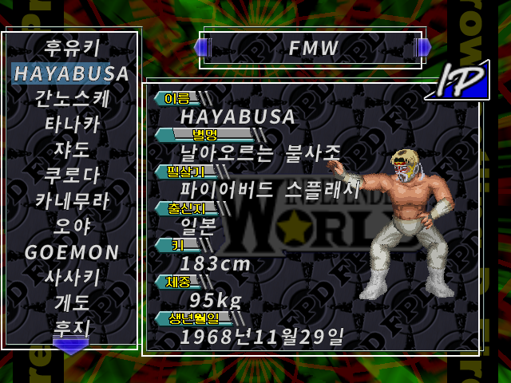
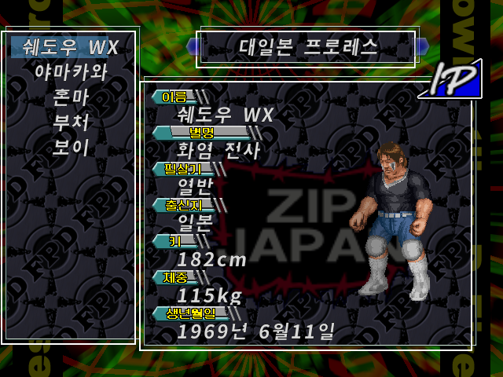

# DC-Fire-Pro-Wrestling-D-Kr · v0.92

**드림캐스트 파이어 프로 레슬링 D 일본판 한글 패치 · 한글화: 기타 깎는 노인**

본편 220명의 실제 링네임을 적용한 v0.92입니다. 사용자 명단 196명 검수 결과로 이름 69건을 교정했고 긴 영문 이름의 목록 잘림을 보정했습니다. **[v0.92 수정 내용 전체 표](docs/CHANGES_0_92.md)**.

## 다운로드와 적용

[**v0.92 릴리스 / EXE 다운로드**](https://github.com/OldManCraveGuitars-bit/DC-Fire-Pro-Wrestling-D-Kr/releases/tag/v0.92)

1. Windows 10/11 x64에서 `FireProD-Kr-v0.92-Patcher.exe`를 실행합니다. Python 설치는 필요 없습니다.
2. 패치 전 일본판 원본 CHD 또는 원본 50트랙 GDI를 선택합니다. GDI는 트랙 파일도 같은 폴더에 있어야 합니다.
3. 약 5GB 이상의 여유 공간이 있는 새 출력 폴더를 지정합니다.
4. 결과 `FireProD-KR-v0.92.gdi`와 트랙 50개를 함께 사용하고 새로 부팅합니다. 이전 세이브스테이트를 이어 쓰지 마세요.

원본과 기존 출력 폴더를 덮어쓰지 않으며 적용 전후 50트랙 해시를 확인합니다. 압축 방식이 다른 CHD는 컨테이너 해시가 다를 수 있으므로 이 경우 원본 GDI로 추출한 뒤 트랙 해시를 대조하세요. 깨끗한 VMU에서 숨김 선수가 안 보이면 모드 선택 화면에서 **L+R+Y를 동시에** 눌러 원작 해금 커맨드를 사용하세요.

## v0.92 수정 사항

| 단체 | 실명 누락 교정 | 표기·별칭 정리 |
|---|---|---|
| 신일본 프로레슬링 | 0 | 4 |
| 전일본 프로레슬링 | 0 | 2 |
| NOAH | 0 | 1 |
| FMW | 0 | 4 |
| 미치노쿠 프로레스 | 0 | 4 |
| 투용문 | 0 | 4 |
| 대일본 프로레스 | 0 | 2 |
| 오사카 프로레스 | 0 | 1 |
| FREE | 0 | 7 |
| WCW | 0 | 6 |
| AAA | 0 | 1 |
| RINGS | 7 | 0 |
| 판크라스 | 4 | 0 |
| 격투탐정단 바트라츠 | 4 | 0 |
| 격투가 | 18 | 0 |

- 실명 누락 33건과 표기·별칭 36건을 반영했습니다.
- HAYABUSA·GOEMON·쉐도우 WX를 같은 24px 글꼴로 표시하도록 목록 폭과 행 위치를 조정했습니다.
- 이름 교정 후 격투가 목록의 글리프 캐시를 128칸으로 늘려 반복 이동 8~9프레임을 확인했습니다.
- 기존 선수 능력·외형·기술·별명·DLC 및 이미지 데이터는 보존했습니다.

이름 변경 69건 전체 표

| 단체 | ID | v0.91 | v0.92 | 구분 |
|---|---|---|---|---|
| 신일본 프로레슬링 | 28 | 아키라 | AKIRA | 표기·별칭 정리 |
| 신일본 프로레슬링 | 23 | 스콧 노턴 | 스콧 노튼 | 표기·별칭 정리 |
| 신일본 프로레슬링 | 24 | 슈퍼 J | Super J | 표기·별칭 정리 |
| 신일본 프로레슬링 | 12 | 쥬신 선더 라이거 | 쥬신 썬더라이거 | 표기·별칭 정리 |
| 전일본 프로레슬링 | 65 | 도리 펑크 주니어 | 도리 펑크 Jr | 표기·별칭 정리 |
| 전일본 프로레슬링 | 50 | 스탠 핸슨 | 스턴 한센 | 표기·별칭 정리 |
| NOAH | 51 | 베이더 | 빅 반 베이더 | 표기·별칭 정리 |
| FMW | 69 | 하야부사 | HAYABUSA | 표기·별칭 정리 |
| FMW | 72 | 미스터 간노스케 | Mr 간노스케 | 표기·별칭 정리 |
| FMW | 75 | 자도 | 쟈도 | 표기·별칭 정리 |
| FMW | 216 | 고에몬 | GOEMON | 표기·별칭 정리 |
| 미치노쿠 프로레스 | 81 | 그란 하마다 | 구란 하마다 | 표기·별칭 정리 |
| 미치노쿠 프로레스 | 80 | 그레이트 사스케 | 더 그레이트 사스케 | 표기·별칭 정리 |
| 미치노쿠 프로레스 | 82 | 타이거 마스크 IV | 타이거 마스크 4세 | 표기·별칭 정리 |
| 미치노쿠 프로레스 | 85 | 커리맨 | 카레 맨 | 표기·별칭 정리 |
| 투용문 | 87 | 시마 | CIMA | 표기·별칭 정리 |
| 투용문 | 86 | 매그넘 도쿄 | 매그넘 TOKYO | 표기·별칭 정리 |
| 투용문 | 89 | 스와 | SUWA | 표기·별칭 정리 |
| 투용문 | 90 | 스모 댄디 후지2000 | 스모 후지 2000 | 표기·별칭 정리 |
| 대일본 프로레스 | 92 | 섀도 WX | 쉐도우 WX | 표기·별칭 정리 |
| 대일본 프로레스 | 95 | 멘즈 테이오 | 테리 보이 | 표기·별칭 정리 |
| 오사카 프로레스 | 97 | 슈퍼 델핀 | 스펠 델핀 | 표기·별칭 정리 |
| FREE | 118 | 그레이트 가부키 | 더 그레이트 카부키 | 표기·별칭 정리 |
| FREE | 105 | 미스터 포고 | Mr 포고 | 표기·별칭 정리 |
| FREE | 107 | 사노 나오키 | 사노 타쿠마 | 표기·별칭 정리 |
| FREE | 115 | 타이거 지트 싱 | 타이거 제트 싱 | 표기·별칭 정리 |
| FREE | 116 | 사부 | Sabu | 표기·별칭 정리 |
| FREE | 117 | 롭 밴 댐 | 롭 반담 | 표기·별칭 정리 |
| FREE | 83 | 그란 나니와 | 구란 나니와 | 표기·별칭 정리 |
| WCW | 153 | 릭 스타이너 | 릭 슈타이너 | 표기·별칭 정리 |
| WCW | 154 | 스콧 스타이너 | 스콧 슈타이너 | 표기·별칭 정리 |
| WCW | 146 | 랜디 새비지 | 마초 맨 | 표기·별칭 정리 |
| WCW | 148 | 케빈 내시 | 케빈 내쉬 | 표기·별칭 정리 |
| WCW | 152 | 그레이트 무타 | 더 그레이트 무타 | 표기·별칭 정리 |
| WCW | 156 | 제프 제럿 | 제프 자렛 | 표기·별칭 정리 |
| AAA | 163 | 닥터 와그너Jr. | Dr 와그너 Jr | 표기·별칭 정리 |
| RINGS | 172 | 사에바 아키라 | 마에다 아키라 | 실명 누락 교정 |
| RINGS | 166 | 미네무라 타카시 | 타무라 키요시 | 실명 누락 교정 |
| RINGS | 168 | 카와모토 노부히로 | 야마모토 요시히사 | 실명 누락 교정 |
| RINGS | 167 | 호사카 타이시 | 코사카 츠요시 | 실명 누락 교정 |
| RINGS | 169 | 리카르도 가브리엘 | 비타제 타리엘 | 실명 누락 교정 |
| RINGS | 170 | 울프 번 | 볼크 한 | 실명 누락 교정 |
| RINGS | 171 | 랜스 하이먼 | 한스 나이만 | 실명 누락 교정 |
| 판크라스 | 173 | 히가키 마코토 | 후나키 마사카츠 | 실명 누락 교정 |
| 판크라스 | 174 | 센도 유키 | 곤도 유키 | 실명 누락 교정 |
| 판크라스 | 175 | 타카이시 토시키 | 타카하시 요시키 | 실명 누락 교정 |
| 판크라스 | 176 | 뵘 슈투름 | 세미 쉴트 | 실명 누락 교정 |
| 격투탐정단 바트라츠 | 178 | 헤라클레스 오즈키 | 알렉산더 오츠카 | 실명 누락 교정 |
| 격투탐정단 바트라츠 | 177 | 이시하라 후유나리 | 이시카와 유키 | 실명 누락 교정 |
| 격투탐정단 바트라츠 | 179 | 무함마드 토네 | 무하마드 요네 | 실명 누락 교정 |
| 격투탐정단 바트라츠 | 181 | 미타카 류토 | 히다카 이쿠토 | 실명 누락 교정 |
| 격투가 | 183 | 카시와다 카즈키 | 사쿠라바 카즈시 | 실명 누락 교정 |
| 격투가 | 182 | 노가와 히로야 | 오가와 나오야 | 실명 누락 교정 |
| 격투가 | 184 | 카지타 마사유키 | 후지타 카즈유키 | 실명 누락 교정 |
| 격투가 | 186 | 사다케 마사유키 | 사타케 마사아키 | 실명 누락 교정 |
| 격투가 | 187 | 센넨 키노시타 | 엔센 이노우에 | 실명 누락 교정 |
| 격투가 | 188 | 카토 후미야 | 사토 루미나 | 실명 누락 교정 |
| 격투가 | 189 | 이누가미 카즈요시 | 무라카미 카즈나리 | 실명 누락 교정 |
| 격투가 | 200 | 네버랜드 로슈 | 롤랑드 보크 | 실명 누락 교정 |
| 격투가 | 190 | 헤라클레스 알레빈 | 알렉산더 카렐린 | 실명 누락 교정 |
| 격투가 | 193 | 닉슨 스테이시 | 힉슨 그레이시 | 실명 누락 교정 |
| 격투가 | 194 | 보이스 스테이시 | 호이스 그레이시 | 실명 누락 교정 |
| 격투가 | 191 | 루갈 로브한킨 | 이고르 보브찬친 | 실명 누락 교정 |
| 격투가 | 192 | 마이크 베어 | 마크 커 | 실명 누락 교정 |
| 격투가 | 125 | 케인 하록 | 켄 샴락 | 실명 누락 교정 |
| 격투가 | 196 | 치타 카를 | 피터 아츠 | 실명 누락 교정 |
| 격투가 | 197 | 호넷 고스트 | 어네스토 호스트 | 실명 누락 교정 |
| 격투가 | 198 | 베이크 게르하르트 | 마이크 베르나르도 | 실명 누락 교정 |
| 격투가 | 199 | 안드레 파그 | 앤디 훅 | 실명 누락 교정 |

## 실제 화면

### HAYABUSA와 GOEMON 목록 표시

### 쉐도우 WX

### 사쿠라바 카즈시

### 세미 쉴트

### 배포 EXE 결과의 RetroArch BIOS 부팅

## SHA-256

| 대상 | 크기(bytes) | SHA-256 |
|---|---|---|
| 일본판 원본 CHD | 689500532 | e111b7fcbeb8ad1089e4d37544dd3255b3d45cea7b959837ca1ecaf1b51b0379 |
| original03.bin | 104254752 | 7c7a70d37c16e86af23e4be0f1e49fdbeff83edbe061a77c08dab2b2fbc9bf04 |
| original50.bin | 111480096 | 1fa975948879af74f7ab72074293ec8db44b83bb781b7a75060d3b0a171160a0 |

배포 EXE·소스 ZIP의 해시는 [배포 파일 해시](docs/ASSET_HASHES.md), 전체 트랙은 [50트랙 해시](docs/TRACK_HASHES.md)를 참고하세요. 릴리스에도 `SHA256SUMS.txt`와 `hashes.json`을 제공합니다.

## 기존 한글화와 추가 콘텐츠

| 항목 | 내용 |
|---|---|
| 한글화 | 타이틀·주요 메뉴·기술·프로필·제작진, 반각 띄어쓰기 |
| 한글 입력 | 현대 한글 11,172음절·자모 51자, ㄱ+ㅏ+ㄱ → 각, 조합 삭제 |
| 본편 선수 이름 | 220명 전원 실제 링네임 설정. 이번 명단 검수 196명, WWF 24명 기존 설정 유지 |
| 공식 다운로드 기술 | W00~W56, 57개 |
| Z 이식 기술 | W57~W99, 43개 |
| 추가 선수 | 46명, 이름 교정 43명(실존 41·VF 게스트 1·마스코트 1) |
| 기존 지연 개선 | 단체 이적·선수 선택·문자 입력의 기존 개선 코드 유지 |
| GDI 구조 | 50트랙·47개 오디오·원본 부트 영역 보존 |

게임 화면에는 공식/이식 기술의 출처 표식이 없습니다. 카드의 E04 선수를 불러오면 카드 데이터가 내장 추가 선수보다 우선합니다.

DLC 기술 100개와 추가 선수 46명 상세 표

# 내장 DLC와 추가 콘텐츠 전체 표

공식 기술 57개 + 커뮤니티 이식 기술 43개 + 추가 선수 46명입니다. W 번호는 내부 저장 슬롯이며 화면의 표시 순서나 출처 표식이 아닙니다. 현재 게임 화면에 공식/이식 구분 표시는 없고, W05와 W79는 모두 샤이닝 위저드입니다.

## 공식 다운로드 기술 57개

| 슬롯 | 현재 한글 기술명 | 원본 기술명 |
|---|---|---|
| W00 | 블레이징 토네이도 | ブレイジングトルネード |
| W01 | 에펠 드 파라슈트 | エッフェル・ド・パラシュート |
| W02 | 데들리 고 라운드 | デッドリー・ゴーラウンド |
| W03 | 머슬 버스터 | マッスル・バスター |
| W04 | 시라누이 | Ｓｈｉｒａｎｕｉ　（Ｓｅａ　Ｆｉｒｅ） |
| W05 | 샤이닝 위저드 | シャイニングウィザード |
| W06 | 웜 | ワーム |
| W07 | 보디 시저스 프런트 넥록 | 胴絞めフロントネックロック |
| W08 | 버펄로 슬리퍼 | バッファロースリーパー |
| W09 | 라스트 라이드 | ラストライド |
| W10 | 카마모토 난무 | 鎌本乱舞 |
| W11 | 스트라이크 스리 | ストライクスリー |
| W12 | 브라질리언 킥 러시 | ブラジリアンキックラッシュ |
| W13 | 내가 사가미다 | オレが相模 |
| W14 | 피닉스 킥 | フェニックスキック |
| W15 | 론다트 캥거루 킥 | ロンダートカンガルーキック |
| W16 | 사이드 저먼 수플렉스 | 横抱え式ジャーマンスープレックス |
| W17 | 고속 드래곤 스크루 | 高速ドラゴンスクリュー |
| W18 | 터보 드롭 II | ターボ・ドロップＩＩ |
| W19 | 슈퍼 킥 | スーパー・キック |
| W20 | 어메이즈 임팩트 | アメイズインパクト |
| W21 | 뒤통수 니킥 | 後頭部膝蹴り |
| W22 | 코브라 홀드 | コブラホールド |
| W23 | 트리플 문설트 프레스 | トリプルムーンサルトプレス |
| W24 | 캐틀 뮤틸레이션 | キャトルミューティレイション |
| W25 | 톱로프 타이거 드라이버 | 雪崩式タイガードライバー |
| W26 | 암 트랩 레그 스위프 | Ｌｅｇ　Ｓｗｅｅｐ　ｗ／ａｒｍ |
| W27 | 블레이징 찹 | ブレイジングチョップ |
| W28 | 프런트 헤드록 | Ｆｒｏｎｔ　Ｈｅａｄｌｏｃｋ　 |
| W29 | 코너 샤이닝 위저드 | 串刺し式シャイニングウィザード |
| W30 | 앵클 홀드 | アンクルホールド |
| W31 | 미츠루 스페셜 II | ミツルスペシャルＩＩ |
| W32 | 데드 엔드 | デッドエンド |
| W33 | 컴플리트 샷 | コンプリートショット |
| W34 | 어깨 태우기 페이스버스터 | 肩車フェイスバスター |
| W35 | 파이널 앤서? | ファイナルアンサー？ |
| W36 | 리버스 수차 드롭 | リバース水車落とし |
| W37 | 사이클링 야호 | サイクリング・ヤッホー |
| W38 | 스카이 하이 초크슬램 | スカイハイ・チョークスラム |
| W39 | 샤이닝 켄카 킥 | シャイニングケンカキック |
| W40 | 펜듈럼 다이아몬드 커터 | 振り子式ダイヤモンドカッター |
| W41 | 슈바인 | シュバイン |
| W42 | 쿠아 러시 | クアラッシュ |
| W43 | 시저스 킥 | シザースキック |
| W44 | 하이퍼 니 쿠가 | ハイパー二ー空牙 |
| W45 | 넥록 암록 | 首極めアームロック |
| W46 | 정수리 니킥 | 脳天膝蹴り |
| W47 | 토털 일리미네이션 | トータル・イリミネーション |
| W48 | 스트레치 머플러 | Ｓｔｒｅｔｃｈ　Ｍｕｆｆｌｅｒ |
| W49 | 요코스카 커터 | 横須賀カッター |
| W50 | 키지 MAX 홀드 | キジＭＡＸホールド |
| W51 | 자이언트 프레스 | Ｇｉａｎｔ　Ｐｒｅｓｓ |
| W52 | 크레이지 사이클론 | クレイジーサイクロン |
| W53 | 타란툴라 | Ｔａｒａｎｔｕｌａ |
| W54 | 바나나 스프레드 | バナナスプレッド |
| W55 | 골든 레프트 | ゴールデンレフト |
| W56 | 문설트 풋스탬프 | ムーンサルトフットスタンプ |

## 커뮤니티 Z 이식 기술 43개

| 슬롯 | 현재 한글 기술명 | 원본 기술명 |
|---|---|---|
| W57 | 대회전 DDT | 大旋回式ＤＤＴ |
| W58 | 리어 넥브레이커 드롭 | 背面ネックブリーカードロップ |
| W59 | 급소 차기 | 急所蹴り |
| W60 | 리어 폴링 페이스버스터 | 背面落下式フェイスバスター |
| W61 | 피겨 포 넥록 | 首四の字固め |
| W62 | 터닝 댄스 | ターニングダンス |
| W63 | 무릎 꿇고 연속 킥 | 膝突き蹴り連打 |
| W64 | 코너 스피어 | 串刺しスピアー |
| W65 | 엘보 버트 | エルボーバット |
| W66 | 무릎 뒤 태클 | 膝裏タックル |
| W67 | 트라이앵글 랜서 | トライアングルランサー |
| W68 | 저공 안면 드롭킥 | 顔面低空ドロップキック |
| W69 | 발로 누르기 | 踏みつけフォール |
| W70 | 암 트랩 스피닝 힐킥 | 腕取り逆回し蹴り |
| W71 | 자신을 가리키는 포즈 | ○ 自分指差しガッツポーズ |
| W72 | 로프 끌기형 | ロープ引きずり刑 |
| W73 | 카류도 | 刈龍怒 |
| W74 | 레그 트랩 엘보 레그록 | 足取りエルボーレッグロック |
| W75 | 코너 연속 찍기 | コーナー叩きつけ連打 |
| W76 | 프랑켄슈타이너 휩 | フランケンシュタイナーホイップ |
| W77 | 플라잉 니킥 | 飛び膝蹴り |
| W78 | 블레이드 킥 | ブレードキック |
| W79 | 샤이닝 위저드 | シャイニングウィザード |
| W80 | 마술사 포즈 | 魔術師ポーズ |
| W81 | 브레인 클로 | ブレーンクロー |
| W82 | 리버스 친 크러셔 | リバースチンクラッシャー |
| W83 | 보디 테이크다운 | 抱え倒し |
| W84 | 스윙 다이빙 프랑켄휩 | スイング式ダイビングフランケンホイップ |
| W85 | 마운트 엘보 | 馬乗りエルボー |
| W86 | 컴플리트 더스트 | コンプリートダスト |
| W87 | 암 슬램 | アームスラム |
| W88 | 다이빙 브레인 찹 | ダイビングブレーンチョップ |
| W89 | 롤링 리버스 니바 | 足掛け前転裏膝十字固め |
| W90 | 풋 트랩 암록 | 足踏み腕固め |
| W91 | 복부 킥 | 腹蹴り |
| W92 | 점핑 가드 포지션 | 飛びつきガードポジション |
| W93 | 잉글랜드 스트레치 | イングランドストレッチ |
| W94 | 아토믹 드롭 & 백드롭 | アトミックドロップ＆バックドロップ |
| W95 | 귀 기울이는 포즈 | 聞き耳パフォーマンス |
| W96 | 풀넬슨 아토믹 봄 | フルネルソンアトミックボム |
| W97 | 더건 해머 | ドゥガンハンマー |
| W98 | 리버스 고리 스페셜 봄 | リバースゴリースペシャルボム |
| W99 | 데자뷔 | デジャヴ |

## 추가 선수 46명

원본 팩의 활성 레코드 46명을 내장합니다. 이름 교정 43명 중 실존 선수는 41명이고, VF 게스트 1명과 원작 마스코트 1명은 별도 구분합니다. 나머지 3명은 기존 표기를 유지합니다.

| 팩/슬롯 | 게임 내 단체 | 원본 → 현재 이름 | 인물/구분 | 별명 | 필살기 |
|---|---|---|---|---|---|
| SPIKE1_4:0 | NOAH | タランチュラ → 투 콜드 스콜피오 | 2 Cold Scorpio 실제 링네임 교정 | 링의 DJ | 슈퍼 타란툴라 스플래시 |
| SPIKE1_4:1 | FMW | 亡霊 → 온료 | Onryo 실제 링네임 교정 | 격투하는 유령의 집 | 망령 클러치 |
| SPIKE1_4:2 | NOAH | 角辻 / 尚道 → 마루후지 나오미치 | Naomichi Marufuji 실제 링네임 교정 | 비행 청년 | 시라누이 |
| SPIKE1_4:3 | 투용문 | 満田 / 靖志 → 칸다 야스시 | Yasushi Kanda 실제 링네임 교정 | 인생 하극상 | 돌핀 D 엘보 드롭 |
| SPIKE1_4:4 | 투용문 | 後月 / 亨 → 모치즈키 스스무 | Susumu Mochizuki 실제 링네임 교정 | N2M의 돌격병 | 하와이안 크러셔 |
| SPIKE1_4:5 | 격투가 | 火野 / マサル → 우노 카오루 | Kaoru Uno 실제 링네임 교정 | 슈팅 프린스 | 시저스 초크 슬리퍼 |
| SPIKE1_4:6 | 격투가 | バッドエッジ / グーリー → 게리 굿리지 | Gary Goodridge 실제 링네임 교정 | 검은 탄환 | 괴력 러시 |
| SPIKE1_4:7 | 신일본 프로레슬링 | 慶三 / 観月 → 스즈키 켄조 | Kenzo Suzuki 실제 링네임 교정 | 골든 루키 | 급강하 백드롭 |
| SPIKE1_4:8 | 여자 | Ｔｏｍｏ / ミルキー → 캔디 오쿠츠 | Candy Okutsu 실제 링네임 교정 | 프리티 테크니션 | 문설트 프레스 |
| SPIKE1_4:9 | 전일본 프로레슬링 | 淡谷 / 伸久 → 아라야 노부타카 | Nobutaka Araya 실제 링네임 교정 | 브랜뉴 선더 | 문설트 프레스 |
| SPIKE2_4:0 | 격투가 | 山路 / 章 → 쇼지 아키라 | Akira Shoji 실제 링네임 교정 | 일본 남아 | 십자 팔 꺾기 |
| SPIKE2_4:1 | 격투가 | オールマン / マイク → 마크 콜먼 | Mark Coleman 실제 링네임 교정 | 궁극의 쇠망치 | 마운트 헤드버트 |
| SPIKE2_4:2 | FREE | マイト / スティル → 스티브 라이트 | Steve Wright 실제 링네임 교정 | 뱀의 굴에서 온 자객 | 로메로 스페셜 |
| SPIKE2_4:3 | FREE | 風車 / 理論 → 풍차 이론 |  실존 모델 미확정·기존 표기 유지 | 불타는 혼 | 백드롭 |
| SPIKE2_4:4 | FREE | カン / ダーシー → 배리 윈덤 | Barry Windham 실제 링네임 교정 | 클래식 | 필살 저먼 수플렉스 |
| SPIKE2_4:5 | RINGS | オフライン / ヴァレンチノ → 발렌타인 오브레임 | Valentijn Overeem 실제 링네임 교정 | 네덜란드의 신성 | 변속 킥 |
| SPIKE2_4:6 | 격투가 | シルバ / ガンマレイ・ダ → 반델라이 실바 | Wanderlei Silva 실제 링네임 교정 | 전율의 니킥 | 마운트 너클 애로 |
| SPIKE2_4:7 | RINGS | クーバー / アンディ → 랜디 커투어 | Randy Couture 실제 링네임 교정 | 그루섬의 제왕 | 마운트 너클 애로 |
| SPIKE2_4:8 | FREE | 疑似狼 / （ギジロウ） → 울프 호크필드 | Wolf Hawkfield VF 게스트 캐릭터 | 리얼 파이터 | 자이언트 스윙 |
| SPIKE2_4:9 | LEGEND | 平成 / デルフィン人間 → 헤이세이 델핀 인간 |  실존 모델 미확정·기존 표기 유지 | 멈추지 않는 비상벨 | 헤이델식 사도 |
| SPIKE6:0 | LEGEND | 信濃 / ストロング → 사카구치 세이지 | Seiji Sakaguchi 실제 링네임 교정 | 세계의 큰 발 | 아르헨티나 백브레이커 |
| SPIKE6:1 | LEGEND | マサ / ゾンビ → 마사 사이토 | Masa Saito 실제 링네임 교정 | 감옥의 야수 | 리프트업 백드롭 |
| SPIKE6:2 | LEGEND | ハーン / モンゴル → 킬러 칸 | Killer Khan 실제 링네임 교정 | 몽골 제국의 혈족 | 다이빙 더블 니 드롭 |
| SPIKE6:3 | LEGEND | 会津 / 義幸 → 야츠 요시아키 | Yoshiaki Yatsu 실제 링네임 교정 | 원더 파워 | 원더 수플렉스 |
| SPIKE6:4 | LEGEND | 源 / ヒットマン → 아슈라 하라 | Ashura Hara 실제 링네임 교정 | 피에 물든 아수라 | 히트맨 래리어트 |
| SPIKE6:5 | LEGEND | 矢島 / ゴールドアーム → 와지마 히로시 | Hiroshi Wajima 실제 링네임 교정 | 황금의 팬츠 | 야지마 스페셜 |
| SPIKE6:6 | LEGEND | マーベリック / ディック → 딕 머독 | Dick Murdoch 실제 링네임 교정 | 서부의 광견 | 시간차 수직낙하 버스터 |
| SPIKE6:7 | LEGEND | デイビス / ミリオンダラー → 테드 디비아시 | Ted DiBiase 실제 링네임 교정 | 미스터 고저스 | 밀리언 달러 버스터 |
| SPIKE6:8 | LEGEND | アレン / ブラッディ → 배드 뉴스 앨런 | Bad News Allen 실제 링네임 교정 | 검은 악의 거성 | 오클라호마 스탬피드 |
| SPIKE6:9 | LEGEND | マックランド / モス → 밥 백런드 | Bob Backlund 실제 링네임 교정 | MSG의 제왕 | 치킨윙 페이스록 |
| SPIKE7:0 | WWF | ジャイアン / デッドリー → 버버 레이 더들리 | Bubba Ray Dudley 실제 링네임 교정 | 광란의 테이블 킹 | 3D |
| SPIKE7:1 | WWF | ビートン / デッドリー → 디본 더들리 | D-Von Dudley 실제 링네임 교정 | 갈색의 테이블 운반꾼 | 리버스 브레인버스터 |
| SPIKE7:2 | WWF | ＫＡＩＪＩ → 타지리 | Tajiri 실제 링네임 교정 | 오페라 극장의 괴인 | 버즈소 킥 |
| SPIKE7:3 | AAA | プリンス / シルバー → 실버 킹 | Silver King 실제 링네임 교정 | 멕시칸 카우보이 | 할리우드 스타 프레스 |
| SPIKE7:4 | AAA | リベラ / ギャランドゥー → 후벤투드 게레라 | Juventud Guerrera 실제 링네임 교정 | 매혹의 에스트레야 | 미치노쿠 드라이버 2 |
| SPIKE_9:0 | 오사카 프로레스 | Ｂｏｍｂａ → 감마 | Gamma 실제 링네임 교정 | 금발의 소악마 | 봄바 슬래시 |
| SPIKE_9:1 | 오사카 프로레스 | 魔王 / ＷＡＬＴＺ → 다이오 QUALLT | Daio QUALLT 실제 링네임 교정 | 나니와의 대마왕 | 자이언트 초크슬램 |
| SPIKE_9:2 | 오사카 프로레스 | ツカサ → 츠바사 | Tsubasa 실제 링네임 교정 | 아시안 토네이도 | 토르나도 데 아카풀코 |
| SPIKE_9:3 | 오사카 프로레스 | バンガロー / デラックス → 블랙 버펄로 | Black Buffalo 실제 링네임 교정 | 야구계에서 온 괴인 X | 방갈로 드라이버 |
| SPIKE_9:4 | FREE | 橋沢 / 直弘 → 호시카와 나오히로 | Naohiro Hoshikawa 실제 링네임 교정 | 방랑하는 유성 | 스페셜 유성 킥 |
| SPIKE10:0 | WWF | Ｊｅｆｆ / Ｈａｒｄｙ → 제프 하디 | Jeff Hardy 실제 링네임 교정 | 신형 핵탄두 | 스완턴 밤 |
| SPIKE10:1 | WWF | Ｈａｒｄｙ / Ｍａｔｔ → 매트 하디 | Matt Hardy 실제 링네임 교정 | 천둥 소년 | 트위스트 오브 페이트 |
| SPIKE10:2 | WCW | ｒｉｏ　ｊｒ / Ｒｅｙ　Ｍｉｓｔｅ → 레이 미스테리오 주니어 | Rey Mysterio Jr. 실제 링네임 교정 | 스몰 솔저 | 다이빙 넥브레이커 드롭 |
| SPIKE10:3 | 격투탐정단 바트라츠 | 園田 / 真澄 → 소노다 마스미 |  격투가·슈트 계열 표기 유지 | 격투의 구렁이 | 후지와라 암바 |
| SPIKE10:4 | 신일본 프로레슬링 | 野中 / レイジング → 호나가 노리오 | Norio Honaga 실제 링네임 교정 | 노련한 명인 | 점핑 넥브레이커 드롭 |
| SPIKE_12:0 | FREE | ファイプロ君 / ミスター → 미스터 파이프로군 | Mister Fire Pro 원작 마스코트 | 시합 판정 레슬러 | 파워밤 |

FREE에는 본편 23명과 추가 6명이 섞입니다. 별도 사용자 단체 21을 참조하던 추가 3명은 빈 카드에서도 보이도록 FREE로 옮깁니다. 나머지 선수의 소속·외형·능력·기술·CPU 로직은 보존합니다.

| FREE 추가 선수 | 현재 표시명 | 원본 소속 ID |
|---|---|---|
| SPIKE2_4:2 | 스티브 라이트 | 8 |
| SPIKE2_4:3 | 풍차 이론 | 21 |
| SPIKE2_4:4 | 배리 윈덤 | 21 |
| SPIKE2_4:8 | 울프 호크필드 | 21 |
| SPIKE_9:4 | 호시카와 나오히로 | 8 |
| SPIKE_12:0 | 미스터 파이프로군 | 8 |

## 저장 카드와 적용 순서

추가 선수는 확장 편집 데이터 4(E04)에 내장합니다. 카드의 E04를 불러오면 카드의 선수가 우선합니다. 내장 W00~W99 슬롯은 이미 차 있으므로 같은 슬롯의 카드 기술은 자동 불러오기에서 건너뜁니다. 원래 카드에서 불러온 파일에만 덮어쓰는 보호 검사를 유지하며 카드에 자동 저장하지 않습니다.

자료 보존: [Apollo Save Database](https://bucanero.github.io/apollo-saves/DC/fireprowd/). Z 이식 분류와 원본 구조 참고: [ken의 영문 프로젝트](https://github.com/kactusken/Fire-Pro-Wrestling-D-English). 한국어판은 50명 세트가 아닌 확인한 46명 세트를 사용합니다.

본편 220명 전체 이름 표

# 본편 선수 이름 220명 전체 표

220명 전원에 실제 링네임을 적용했습니다. 법적 본명으로 일괄 치환한 목록이 아니며 당시 활동명과 모델을 기준으로 합니다. 이번 사용자 명단 대조는 196명이며 WWF 24명은 기존 실명 설정을 유지했습니다. 원본 열의 `/`는 이름 필드 구분입니다.

## 신일본 프로레슬링

| ID | 원본 이름(필드 1 / 2) | v0.92 표시명 | 실제 링네임 영문 |
|---|---|---|---|
| 0 | 大和 / ファイター | 후지나미 타츠미 | Tatsumi Fujinami |
| 1 | 慶介 / ストーム | 사사키 켄스케 | Kensuke Sasaki |
| 2 | ジロー / サムライ | 코시나카 시로 | Shiro Koshinaka |
| 3 | 宏田 / 純一 | 히라타 준지 | Junji Hirata |
| 4 | 拳悟 / イナズマ | 키무라 켄고 | Kengo Kimura |
| 5 | 水戸 / 勇 | 키도 오사무 | Osamu Kido |
| 6 | 稲塚 / 貴幸 | 이이즈카 타카시 | Takashi Iizuka |
| 7 | 高橋 / 衛 | 나카니시 마나부 | Manabu Nakanishi |
| 8 | 阪田 / 祐次郎 | 나가타 유지 | Yuji Nagata |
| 9 | 益田 / 高男 | 야스다 타다오 | Tadao Yasuda |
| 10 | 草村 / 徹 | 니시무라 오사무 | Osamu Nishimura |
| 11 | 泰江 / 真 | 요시에 유타카 | Yutaka Yoshie |
| 12 | カイザー / 超帝スーパー | 쥬신 썬더라이거 | Jushin Thunder Liger |
| 13 | カミカゼ / Ｅ | 엘 사무라이 | El Samurai |
| 14 | 鎌本 / 鋭司 | 카네모토 코지 | Koji Kanemoto |
| 15 | 大刈 / 真一郎 | 오타니 신지로 | Shinjiro Otani |
| 16 | ヤ・シン / ブシドー | 켄도 카신 | Kendo Kashin |
| 17 | 鷹龍 / 岩人 | 타카이와 타츠히토 | Tatsuhito Takaiwa |
| 18 | 中瀬 / 慎哉 | 마카베 신야 | Shinya Makabe |
| 19 | 河野 / バイオレンス | 초노 마사히로 | Masahiro Chono |
| 20 | 俊藤 / 剣 | 무토 케이지 | Keiji Mutoh |
| 21 | 天本 / バッファロー | 텐잔 히로요시 | Hiroyoshi Tenzan |
| 22 | 木嶋 / 悟 | 코지마 사토시 | Satoshi Kojima |
| 23 | バートン / フラッシュ | 스콧 노튼 | Scott Norton |
| 24 | ハイパーＫ | Super J | Super J |
| 25 | 護東 / トシ | 고토 타츠토시 | Tatsutoshi Goto |
| 26 | 野原 / 道憲 | 오하라 미치요시 | Michiyoshi Ohara |
| 27 | ヒロ / レイジング | 히로 사이토 | Hiro Saito |
| 28 | ＡＳＵＫＡ | AKIRA | AKIRA |
| 29 | 武蔵 / ビクトリー | 안토니오 이노키 | Antonio Inoki |
| 30 | 力丸 / ハリケーン | 초슈 리키 | Riki Choshu |
| 31 | 山本 / 和輝 | 야마자키 카즈오 | Kazuo Yamazaki |
| 32 | 溝口 / シャウト | 애니멀 하마구치 | Animal Hamaguchi |
| 33 | 若元 / 一徹 | 야마모토 코테츠 | Kotetsu Yamamoto |
| 34 | パンサー / マスク・ド | 타이거 마스크 | Tiger Mask |
| 35 | キッド / ダイナミック | 다이너마이트 키드 | Dynamite Kid |
| 36 | 五十嵐 / 利明 | 코바야시 쿠니아키 | Kuniaki Kobayashi |
| 37 | ブラック / パンサー | 블랙 타이거 | Black Tiger |
| 195 | クライ / ボーン | 돈 프라이 | Don Frye |

## 전일본 프로레슬링

| ID | 원본 이름(필드 1 / 2) | v0.92 표시명 | 실제 링네임 영문 |
|---|---|---|---|
| 40 | 風間 / 利家 | 카와다 토시아키 | Toshiaki Kawada |
| 43 | 伊達 / 弘 | 하세 히로시 | Hiroshi Hase |
| 50 | バイソン / スター | 스턴 한센 | Stan Hansen |
| 52 | ジェイムス / スティル | 스티브 윌리엄스 | Steve Williams |
| 53 | ピース / ジョン | 조니 에이스 | Johnny Ace |
| 54 | バン / ビート | 바트 건 | Bart Gunn |
| 55 | ジャッカル / ボールフィード | 짐 스틸 | Jim Steele |
| 56 | ルイス / トニー | 조니 스미스 | Johnny Smith |
| 57 | 熱風 / クア | 타이요 케아 | Taiyo Kea |
| 58 | 小淵沢 / 昌紀 | 후치 마사노부 | Masanobu Fuchi |
| 61 | 牧原 / 武彦 | 카키하라 마사히토 | Masahito Kakihara |
| 63 | 司馬 / グレート | 자이언트 바바 | Giant Baba |
| 64 | トミー / ボンバー | 점보 츠루타 | Jumbo Tsuruta |
| 65 | ハリー / テキサンＪｒ． | 도리 펑크 Jr | Dory Funk Jr. |
| 66 | ブル / ビッグ・ザ・Ｇ | 브루저 브로디 | Bruiser Brody |
| 67 | ボギー / ケリー | 테리 고디 | Terry Gordy |
| 68 | ブライト / Ｇ・Ｏ | 게리 올브라이트 | Gary Albright |
| 100 | 龍 / サンダー | 텐류 겐이치로 | Genichiro Tenryu |

## NOAH

| ID | 원본 이름(필드 1 / 2) | v0.92 표시명 | 실제 링네임 영문 |
|---|---|---|---|
| 38 | 氷川 / 光秀 | 미사와 미츠하루 | Mitsuharu Misawa |
| 39 | 富樫 / 慶次 | 코바시 켄타 | Kenta Kobashi |
| 41 | 相模 / 朗 | 타우에 아키라 | Akira Taue |
| 42 | 秋沢 / 瞬 | 아키야마 준 | Jun Akiyama |
| 44 | 大林 / 剛雄 | 오모리 타카오 | Takao Omori |
| 45 | 甲山 / 良宏 | 타카야마 요시히로 | Yoshihiro Takayama |
| 46 | 本間 / 羅魂 | 혼다 타몬 | Tamon Honda |
| 47 | 泉谷 / 牛角 | 이즈미다 준 | Jun Izumida |
| 48 | 木下 / 孝雄 | 이노우에 마사오 | Masao Inoue |
| 49 | 伊賀 / 仁太郎 | 시가 켄타로 | Kentaro Shiga |
| 51 | セイバー / スター | 빅 반 베이더 | Big Van Vader |
| 59 | 野河 / 芳直 | 오가와 요시나리 | Yoshinari Ogawa |
| 60 | 明智 / 清志 | 키쿠치 츠요시 | Tsuyoshi Kikuchi |
| 62 | 羽丸 / 敏則 | 카네마루 요시노부 | Yoshinobu Kanemaru |
| 110 | 引田 / 大作 | 이케다 다이스케 | Daisuke Ikeda |
| 215 | 力士王 / 崇 | 리키오 타케시 | Takeshi Rikio |

## FMW

| ID | 원본 이름(필드 1 / 2) | v0.92 표시명 | 실제 링네임 영문 |
|---|---|---|---|
| 69 | ランマル | HAYABUSA | HAYABUSA |
| 70 | 畑中 / 雅彦 | 타나카 마사토 | Masato Tanaka |
| 71 | 春樹 / サクソン | 후유키 코도 | Kodo Fuyuki |
| 72 | 芦屋 / Ｍｒ． | Mr 간노스케 | Mister Gannosuke |
| 73 | 室田 / 鉄彦 | 쿠로다 테츠히로 | Tetsuhiro Kuroda |
| 74 | 高矢 / 久勝 | 오야 히사카츠 | Hisakatsu Oya |
| 75 | 魔童 | 쟈도 | Jado |
| 76 | 亀村 / ウィニング | 카네무라 킨타로 | Kintaro Kanemura |
| 77 | 鬼童 | 게도 | Gedo |
| 78 | ロッキー / ツジ | 리키 후지 | Ricky Fuji |
| 216 | ＨＡＮＺＯ | GOEMON | GOEMON |
| 217 | ダイナソー / 高木 | 맘모스 사사키 | Mammoth Sasaki |

## 미치노쿠 프로레스

| ID | 원본 이름(필드 1 / 2) | v0.92 표시명 | 실제 링네임 영문 |
|---|---|---|---|
| 79 | 神崎 / 仁水 | 신자키 진세이 | Jinsei Shinzaki |
| 80 | ハヤテ / ブレード | 더 그레이트 사스케 | The Great Sasuke |
| 81 | マリポーサ / グラン | 구란 하마다 | Gran Hamada |
| 82 | パンサーＩＶ / マスク・ド | 타이거 마스크 4세 | Tiger Mask IV |
| 85 | カリー / マスク | 카레 맨 | Curry Man |

## 투용문

| ID | 원본 이름(필드 1 / 2) | v0.92 표시명 | 실제 링네임 영문 |
|---|---|---|---|
| 86 | ワルサー / ＫＹＯＴＯ | 매그넘 TOKYO | Magnum TOKYO |
| 87 | ＺＹＭＡ | CIMA | CIMA |
| 88 | ジュニア / アステカ | 드래곤 키드 | Dragon Kid |
| 89 | ＫＵＧＡ | SUWA | SUWA |
| 90 | Ｆ２０００ / 菅生・ダンディ | 스모 후지 2000 | Sumo Dandy Fuji 2000 (Don Fujii) |
| 91 | アステカ / ドラゴン | 울티모 드래곤 | Ultimo Dragon |

## 대일본 프로레스

| ID | 원본 이름(필드 1 / 2) | v0.92 표시명 | 실제 링네임 영문 |
|---|---|---|---|
| 92 | ＸＸＸ / ダークネス | 쉐도우 WX | Shadow WX |
| 93 | 河山 / 龍次 | 야마카와 류지 | Ryuji Yamakawa |
| 94 | 相馬 / 智明 | 혼마 토모아키 | Tomoaki Honma |
| 95 | ボーイ / ケリー | 테리 보이 | Terry Boy |
| 96 | デンジャー / アブドル・ザ | 압둘라 더 부처 | Abdullah the Butcher |

## 오사카 프로레스

| ID | 원본 이름(필드 1 / 2) | v0.92 표시명 | 실제 링네임 영문 |
|---|---|---|---|
| 97 | ドルフィン / Ｓ | 스펠 델핀 | Super Delfin |
| 99 | 倉仲 / 武博 | 무라하마 타케히로 | Takehiro Murahama |

## FREE

| ID | 원본 이름(필드 1 / 2) | v0.92 표시명 | 실제 링네임 영문 |
|---|---|---|---|
| 83 | 音羽 / 怒乱 | 구란 나니와 | Gran Naniwa |
| 84 | 梶田 / ミツル | 후지타 미노루 | Minoru Fujita |
| 98 | 西城 / リック | 딕 토고 | Dick Togo |
| 101 | 旗本 / クラッシャー | 하시모토 신야 | Shinya Hashimoto |
| 102 | 梶原 / 丈 | 후지와라 요시아키 | Yoshiaki Fujiwara |
| 103 | 沖田 / 勝志 | 오니타 아츠시 | Atsushi Onita |
| 104 | 五条 / ハンター | 타잔 고토 | Tarzan Goto |
| 105 | トーゴー / マスター | Mr 포고 | Mister Pogo |
| 106 | 安藤 / 障二 | 안조 요지 | Yoji Anjo |
| 107 | 矢野 / 尚樹 | 사노 타쿠마 | Takuma Sano |
| 108 | 松原 / デンジャー | 마츠나가 미츠히로 | Mitsuhiro Matsunaga |
| 109 | 朱井 / 勝也 | 나가이 미츠야 | Mitsuya Nagai |
| 111 | 折倉 / 雅夫 | 오리하라 마사오 | Masao Orihara |
| 112 | 後月 / 正成 | 모치즈키 마사아키 | Masaaki Mochizuki |
| 113 | ナイト / ブラスター | 호크 워리어 | Hawk Warrior |
| 114 | アイアン / ブラスター | 애니멀 워리어 | Animal Warrior |
| 115 | タイガー / マッド | 타이거 제트 싱 | Tiger Jeet Singh |
| 116 | タトゥー | Sabu | Sabu |
| 117 | ランダム / ログ | 롭 반담 | Rob Van Dam |
| 118 | カグラ / ザ・ミステリアス | 더 그레이트 카부키 | The Great Kabuki |
| 144 | ドゥガン / アックス | 헐크 호건 | Hulk Hogan |
| 180 | 谷中 / 充 | 타나카 미노루 | Minoru Tanaka |
| 185 | 真田 / 伸久 | 타카다 노부히코 | Nobuhiko Takada |

## WWF

| ID | 원본 이름(필드 1 / 2) | v0.92 표시명 | 실제 링네임 영문 |
|---|---|---|---|
| 119 | オーディーン / スチーム | 스톤콜드 스티브 오스틴 | Stone Cold Steve Austin |
| 120 | ラック / レイピア | 더 록 | The Rock |
| 121 | グラウンド / ジ・アンダー | 언더테이커 | The Undertaker |
| 122 | トラブルＪ | 트리플 H | Triple H |
| 123 | ギガント / ジョー | 빅 쇼 | Big Show |
| 124 | マイン | 케인 | Kane |
| 126 | ニギー / バン | 빌리 건 | Billy Gunn |
| 127 | ノック / ボーロ | 로드 독 | Road Dogg |
| 128 | Ｗパッケージ | 엑스팍 | X-Pac |
| 129 | スモウ / ファット | 리키쉬 | Rikishi |
| 130 | スミス / マイティボウイ | 데이비 보이 스미스 | Davey Boy Smith |
| 131 | ゲノア / ルイツ | 크리스 벤와 | Chris Benoit |
| 132 | ジェイク / ルイツ | 크리스 제리코 | Chris Jericho |
| 133 | ラテンコ / ディープ | 딘 말렌코 | Dean Malenko |
| 134 | ケリー / ネベロ | 에디 게레로 | Eddie Guerrero |
| 135 | ＫＡＺ | 태즈 | Tazz |
| 136 | コレア | 차이나 | Chyna |
| 137 | ＷＡＫＡ / ゆきぐに | 타카 미치노쿠 | TAKA Michinoku |
| 138 | 船越 / 栄一 | 쇼이치 후나키 | Shoichi Funaki |
| 139 | ロシュモフ / ジャイアント | 앙드레 더 자이언트 | Andre the Giant |
| 140 | シュール / マイルズ | 숀 마이클스 | Shawn Michaels |
| 141 | ドンハウンド | 맨카인드 | Mankind |
| 142 | ディンク / カクラコン | 빈스 맥마흔 | Vince McMahon |
| 218 | バックル / バート | 커트 앵글 | Kurt Angle |

## WCW

| ID | 원본 이름(필드 1 / 2) | v0.92 표시명 | 실제 링네임 영문 |
|---|---|---|---|
| 143 | ウィル / コールドバック | 빌 골드버그 | Bill Goldberg |
| 145 | スレンダー / ディック | 릭 플레어 | Ric Flair |
| 146 | サーベル / マッチョ | 마초 맨 | Macho Man Randy Savage |
| 147 | ブラッド / ビート | 브렛 하트 | Bret Hart |
| 148 | ガッシュ / レビン | 케빈 내쉬 | Kevin Nash |
| 149 | コーズ / スポット | 스콧 홀 | Scott Hall |
| 150 | セット / ディカス | 시드 비셔스 | Sid Vicious |
| 151 | スパイク / ザ | 스팅 | Sting |
| 152 | 武道 / ザ・グレイテスト | 더 그레이트 무타 | The Great Muta |
| 153 | ビッグ / シュタイナー | 릭 슈타이너 | Rick Steiner |
| 154 | スモール / シュタイナー | 스콧 슈타이너 | Scott Steiner |
| 155 | エッジ / Ｄグラス | 다이아몬드 댈러스 페이지 | Diamond Dallas Page |
| 156 | バレット / ビル | 제프 자렛 | Jeff Jarrett |
| 157 | ギガス / スマッシャー・ＧＧ | 뱀 뱀 비글로우 | Bam Bam Bigelow |
| 158 | ゴッサム / バイス | 마이크 어썸 | Mike Awesome |
| 159 | オオハシ / ヤス | 카즈 하야시 | Kaz Hayashi |
| 160 | ケリー / テキサン | 테리 펑크 | Terry Funk |
| 219 | ハッカーＤ | 부커 T | Booker T |

## AAA

| ID | 원본 이름(필드 1 / 2) | v0.92 표시명 | 실제 링네임 영문 |
|---|---|---|---|
| 161 | サントス / Ｅ | 엘 이호 델 산토 | El Hijo Del Santo |
| 162 | カオス / ネグレクト | 네그로 카사스 | Negro Casas |
| 163 | Ｄシルバー / Ｊｒ． | Dr 와그너 Jr | Dr. Wagner Jr. |
| 164 | イーグル / マスカラ | 도스 카라스 | Dos Caras |
| 165 | コンドル / マスカラ | 밀 마스카라스 | Mil Mascaras |

## RINGS

| ID | 원본 이름(필드 1 / 2) | v0.92 표시명 | 실제 링네임 영문 |
|---|---|---|---|
| 166 | 峰村 / 崇 | 타무라 키요시 | Kiyoshi Tamura |
| 167 | 宝坂 / 大志 | 코사카 츠요시 | Tsuyoshi Kosaka |
| 168 | 河本 / 信宏 | 야마모토 요시히사 | Yoshihisa Yamamoto |
| 169 | ガブリエル / リカード | 비타제 타리엘 | Tariel Bitsadze |
| 170 | バーン / ウォルフ | 볼크 한 | Volk Han |
| 171 | ハイマン / ランス | 한스 나이만 | Hans Nijman |
| 172 | 冴刃 / 明 | 마에다 아키라 | Akira Maeda |

## 판크라스

| ID | 원본 이름(필드 1 / 2) | v0.92 표시명 | 실제 링네임 영문 |
|---|---|---|---|
| 173 | 桧垣 / 誠 | 후나키 마사카츠 | Masakatsu Funaki |
| 174 | 千堂 / 勇気 | 곤도 유키 | Yuki Kondo |
| 175 | 高石 / 俊樹 | 타카하시 요시키 | Yoshiki Takahashi |
| 176 | シュトゥルム / ベーム | 세미 쉴트 | Semmy Schilt |

## 격투탐정단 바트라츠

| ID | 원본 이름(필드 1 / 2) | v0.92 표시명 | 실제 링네임 영문 |
|---|---|---|---|
| 177 | 石原 / 冬威 | 이시카와 유키 | Yuki Ishikawa |
| 178 | 大月 / ヘラクレス | 알렉산더 오츠카 | Alexander Otsuka |
| 179 | トネ / ムハンマド | 무하마드 요네 | Muhammad Yone |
| 181 | 三鷹 / 竜斗 | 히다카 이쿠토 | Ikuto Hidaka |

## 격투가

| ID | 원본 이름(필드 1 / 2) | v0.92 표시명 | 실제 링네임 영문 |
|---|---|---|---|
| 125 | ハーロック / ケイン | 켄 샴락 | Ken Shamrock |
| 182 | 野川 / 裕也 | 오가와 나오야 | Naoya Ogawa |
| 183 | 柏田 / 一樹 | 사쿠라바 카즈시 | Kazushi Sakuraba |
| 184 | 梶田 / 政之 | 후지타 카즈유키 | Kazuyuki Fujita |
| 186 | 佐岳 / 雅之 | 사타케 마사아키 | Masaaki Satake |
| 187 | センネン / 木下 | 엔센 이노우에 | Enson Inoue |
| 188 | フミヤ / 加藤 | 사토 루미나 | Rumina Sato |
| 189 | 犬神 / 一義 | 무라카미 카즈나리 | Kazunari Murakami |
| 190 | アレビン / ヘラクレス | 알렉산더 카렐린 | Aleksandr Karelin |
| 191 | ロブハンキン / ルガール | 이고르 보브찬친 | Igor Vovchanchyn |
| 192 | ベアー / マイク | 마크 커 | Mark Kerr |
| 193 | ニクソン / ステイシー | 힉슨 그레이시 | Rickson Gracie |
| 194 | ヴォイス / ステイシー | 호이스 그레이시 | Royce Gracie |
| 196 | カール / チーター | 피터 아츠 | Peter Aerts |
| 197 | ゴースト / ホーネット | 어네스토 호스트 | Ernesto Hoost |
| 198 | ゲルハルト / ベイク | 마이크 베르나르도 | Mike Bernardo |
| 199 | ファグ / アンドレ | 앤디 훅 | Andy Hug |
| 200 | ロッシュ / ネバーランド | 롤랑드 보크 | Roland Bock |

## 여자

| ID | 원본 이름(필드 1 / 2) | v0.92 표시명 | 실제 링네임 영문 |
|---|---|---|---|
| 201 | 那須香 / ティグレス | 라이오네스 아스카 | Lioness Asuka |
| 202 | 中世 / 静香 | 나가요 치구사 | Chigusa Nagayo |
| 203 | 涼子 / 木下 | 이노우에 쿄코 | Kyoko Inoue |
| 204 | 神咲 / しおり | 칸도리 시노부 | Shinobu Kandori |
| 205 | ラジャ / ダンク | 아자 콩 | Aja Kong |
| 206 | 西京 / グレネード | 다이너마이트 칸사이 | Dynamite Kansai |
| 207 | 福生 / 有紀子 | 홋타 유미코 | Yumiko Hotta |
| 208 | 横田 / 奈々美 | 토요타 마나미 | Manami Toyota |
| 209 | 南斗 / 光 | 호쿠토 아키라 | Akira Hokuto |
| 210 | 香奈子 / 木下 | 이노우에 타카코 | Takako Inoue |
| 211 | ブルドーザ / 高尾 | 불 나카노 | Bull Nakano |

## LEGEND

| ID | 원본 이름(필드 1 / 2) | v0.92 표시명 | 실제 링네임 영문 |
|---|---|---|---|
| 212 | クラウザー / カルロス | 칼 고치 | Karl Gotch |
| 213 | フェイズ / Ｒ・Ｊ | 루 테즈 | Lou Thesz |
| 214 | 力皇斬 | 역도산 | Rikidozan |

## 검수와 제한

# v0.92 검수

| 검사 | 결과 |
|---|---|
| 선수 이름 | 명단 196명 대조, 수정 69건 실제 반영, 본편 220명 실명 설정 |
| 실제 화면 | 변경 선수 69명 프로필·단체 18곳 헤더 확인, 변경 이름 영역의 겹침/가로 잘림 0건 |
| 패처 | 실제 EXE: 원본 CHD/GDI 각각 적용, 결과 50트랙 해시 일치, 실패·중단 9사례 |
| RetroArch | 1.22.2 + Flycast, 실제 EXE 결과 GDI, BIOS 부팅, 6,000프레임 후 일반 시합 메뉴 |
| 정적 검사 | 테스트 63개, UI 폭 2,237조건, 압축 스트림 243개·메모리 용량 검사 통과 |
| 격투가 목록 | 첫 이동 1프레임 / 반복 8~9프레임, 90 VBlank 측정 |
| 단체 이적 | 첫 이동 1프레임 / 반복 5~8프레임, 180 VBlank 측정 |
| 문자판 5종 | 한글·가타카나·히라가나·영숫자·기호: 첫 이동 1프레임 / 반복 4프레임 |
| 원본 보존 | 선수 이름·목록 표시·글리프와 캐시 용량 이외의 변경은 바이트 대조로 제한 |
| 검수 범위 | 실물 기기, VMU 저장 후 재부팅, 모든 메뉴/임의 입력/기술 개별 시전 전수 검사는 미완료 |

[수정 표와 전체 범위](docs/CHANGES_0_92.md) · [EXE](docs/patcher-verification-v092.json) · [RetroArch](docs/retroarch-v092-verification.json) · [실제 화면](docs/roster-runtime-v092.json) · [격투가 속도](docs/fighter-performance-v092.json) · [단체 이적](docs/transfer-performance-v092.json) · [문자 입력](docs/input-performance-v092.json)

숨김 선수의 화면 검수는 원작 모드 선택 화면에서 L+R+Y를 동시에 눌러 표시한 뒤 진행했습니다. 깨끗한 VMU에서는 이 커맨드가 필요할 수 있으며 이번 버전에서 숨김 선수 자동 해금 동작을 새로 수정하지 않았습니다.

전용 검수용 Flycast 캡처에서는 일부 프로필 라벨·숫자가 잘리는 장면이 v0.91과 v0.92 모두 관찰되었습니다. 이 렌더링 현상은 미해결이며 RetroArch의 모든 프로필 비교는 미완료입니다. 일부 배너·의상·브라우저 이미지에 일본어가 남아 있습니다. 제작진 인명 18명은 독음 잠정 표기이며 음성 자막 후크는 미완료입니다. 원래 저장 필드 길이를 유지합니다.

## 출처·라이선스·소스

기본 구조와 도구 참고: [ken / Fire Pro Wrestling D English](https://github.com/kactusken/Fire-Pro-Wrestling-D-English) (MIT). 자료 보존: [Apollo Save Database](https://bucanero.github.io/apollo-saves/DC/fireprowd/). 패처 소스와 빌드 설정은 저장소 및 릴리스의 Source-and-Payload ZIP, chdman 대응 소스는 같은 릴리스의 MAME-0.264-source.tar.gz에 제공합니다. 게임 원본과 BIOS는 포함하지 않습니다.
