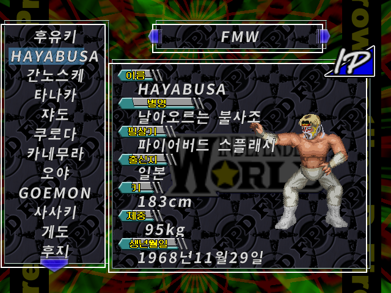
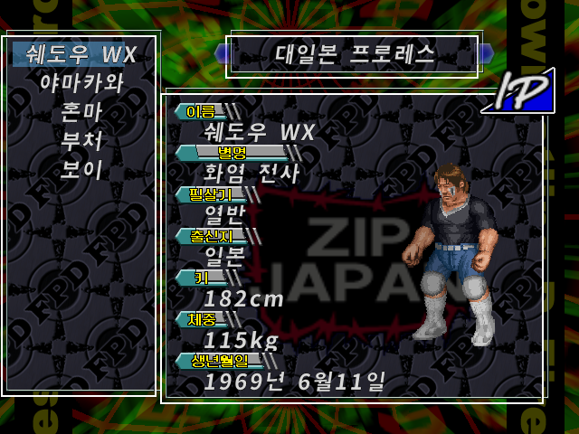
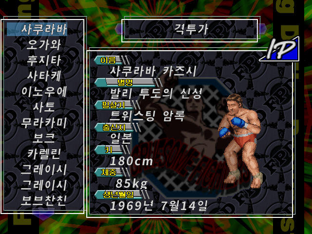
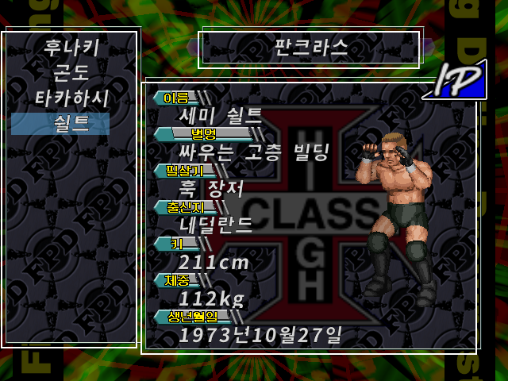
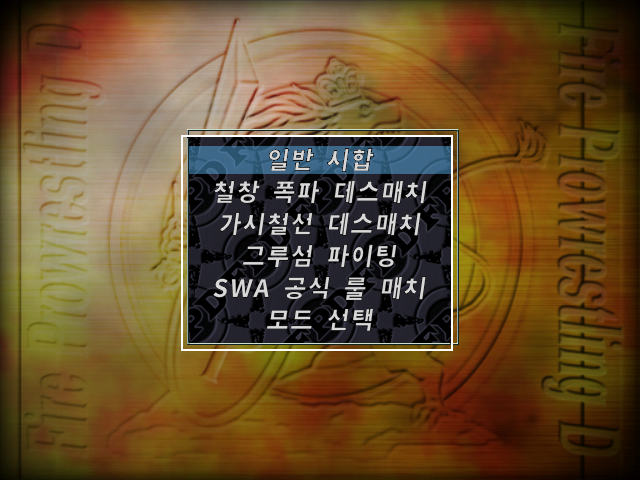

# v0.92 수정 내역

**한글화: 기타 깎는 노인**

v0.91 이후 사용자 명단 196명을 대조하여 이름 69건을 반영했습니다. 실명 누락 33건(RINGS 7·판크라스 4·바트라츠 4·격투가 18)과 표기·별칭 정리 36건입니다. 본편 실명 설정은 187명에서 220명으로 늘었습니다. WWF 24명은 기존 설정을 유지했습니다.

| 단체 | 실명 누락 교정 | 표기·별칭 정리 |
|---|---|---|
| 신일본 프로레슬링 | 0 | 4 |
| 전일본 프로레슬링 | 0 | 2 |
| NOAH | 0 | 1 |
| FMW | 0 | 4 |
| 미치노쿠 프로레스 | 0 | 4 |
| 투용문 | 0 | 4 |
| 대일본 프로레스 | 0 | 2 |
| 오사카 프로레스 | 0 | 1 |
| FREE | 0 | 7 |
| WCW | 0 | 6 |
| AAA | 0 | 1 |
| RINGS | 7 | 0 |
| 판크라스 | 4 | 0 |
| 격투탐정단 바트라츠 | 4 | 0 |
| 격투가 | 18 | 0 |

## 이름 변경 69건 전체 표

| 단체 | ID | v0.91 | v0.92 | 구분 |
|---|---|---|---|---|
| 신일본 프로레슬링 | 28 | 아키라 | AKIRA | 표기·별칭 정리 |
| 신일본 프로레슬링 | 23 | 스콧 노턴 | 스콧 노튼 | 표기·별칭 정리 |
| 신일본 프로레슬링 | 24 | 슈퍼 J | Super J | 표기·별칭 정리 |
| 신일본 프로레슬링 | 12 | 쥬신 선더 라이거 | 쥬신 썬더라이거 | 표기·별칭 정리 |
| 전일본 프로레슬링 | 65 | 도리 펑크 주니어 | 도리 펑크 Jr | 표기·별칭 정리 |
| 전일본 프로레슬링 | 50 | 스탠 핸슨 | 스턴 한센 | 표기·별칭 정리 |
| NOAH | 51 | 베이더 | 빅 반 베이더 | 표기·별칭 정리 |
| FMW | 69 | 하야부사 | HAYABUSA | 표기·별칭 정리 |
| FMW | 72 | 미스터 간노스케 | Mr 간노스케 | 표기·별칭 정리 |
| FMW | 75 | 자도 | 쟈도 | 표기·별칭 정리 |
| FMW | 216 | 고에몬 | GOEMON | 표기·별칭 정리 |
| 미치노쿠 프로레스 | 81 | 그란 하마다 | 구란 하마다 | 표기·별칭 정리 |
| 미치노쿠 프로레스 | 80 | 그레이트 사스케 | 더 그레이트 사스케 | 표기·별칭 정리 |
| 미치노쿠 프로레스 | 82 | 타이거 마스크 IV | 타이거 마스크 4세 | 표기·별칭 정리 |
| 미치노쿠 프로레스 | 85 | 커리맨 | 카레 맨 | 표기·별칭 정리 |
| 투용문 | 87 | 시마 | CIMA | 표기·별칭 정리 |
| 투용문 | 86 | 매그넘 도쿄 | 매그넘 TOKYO | 표기·별칭 정리 |
| 투용문 | 89 | 스와 | SUWA | 표기·별칭 정리 |
| 투용문 | 90 | 스모 댄디 후지2000 | 스모 후지 2000 | 표기·별칭 정리 |
| 대일본 프로레스 | 92 | 섀도 WX | 쉐도우 WX | 표기·별칭 정리 |
| 대일본 프로레스 | 95 | 멘즈 테이오 | 테리 보이 | 표기·별칭 정리 |
| 오사카 프로레스 | 97 | 슈퍼 델핀 | 스펠 델핀 | 표기·별칭 정리 |
| FREE | 118 | 그레이트 가부키 | 더 그레이트 카부키 | 표기·별칭 정리 |
| FREE | 105 | 미스터 포고 | Mr 포고 | 표기·별칭 정리 |
| FREE | 107 | 사노 나오키 | 사노 타쿠마 | 표기·별칭 정리 |
| FREE | 115 | 타이거 지트 싱 | 타이거 제트 싱 | 표기·별칭 정리 |
| FREE | 116 | 사부 | Sabu | 표기·별칭 정리 |
| FREE | 117 | 롭 밴 댐 | 롭 반담 | 표기·별칭 정리 |
| FREE | 83 | 그란 나니와 | 구란 나니와 | 표기·별칭 정리 |
| WCW | 153 | 릭 스타이너 | 릭 슈타이너 | 표기·별칭 정리 |
| WCW | 154 | 스콧 스타이너 | 스콧 슈타이너 | 표기·별칭 정리 |
| WCW | 146 | 랜디 새비지 | 마초 맨 | 표기·별칭 정리 |
| WCW | 148 | 케빈 내시 | 케빈 내쉬 | 표기·별칭 정리 |
| WCW | 152 | 그레이트 무타 | 더 그레이트 무타 | 표기·별칭 정리 |
| WCW | 156 | 제프 제럿 | 제프 자렛 | 표기·별칭 정리 |
| AAA | 163 | 닥터 와그너Jr. | Dr 와그너 Jr | 표기·별칭 정리 |
| RINGS | 172 | 사에바 아키라 | 마에다 아키라 | 실명 누락 교정 |
| RINGS | 166 | 미네무라 타카시 | 타무라 키요시 | 실명 누락 교정 |
| RINGS | 168 | 카와모토 노부히로 | 야마모토 요시히사 | 실명 누락 교정 |
| RINGS | 167 | 호사카 타이시 | 코사카 츠요시 | 실명 누락 교정 |
| RINGS | 169 | 리카르도 가브리엘 | 비타제 타리엘 | 실명 누락 교정 |
| RINGS | 170 | 울프 번 | 볼크 한 | 실명 누락 교정 |
| RINGS | 171 | 랜스 하이먼 | 한스 나이만 | 실명 누락 교정 |
| 판크라스 | 173 | 히가키 마코토 | 후나키 마사카츠 | 실명 누락 교정 |
| 판크라스 | 174 | 센도 유키 | 곤도 유키 | 실명 누락 교정 |
| 판크라스 | 175 | 타카이시 토시키 | 타카하시 요시키 | 실명 누락 교정 |
| 판크라스 | 176 | 뵘 슈투름 | 세미 쉴트 | 실명 누락 교정 |
| 격투탐정단 바트라츠 | 178 | 헤라클레스 오즈키 | 알렉산더 오츠카 | 실명 누락 교정 |
| 격투탐정단 바트라츠 | 177 | 이시하라 후유나리 | 이시카와 유키 | 실명 누락 교정 |
| 격투탐정단 바트라츠 | 179 | 무함마드 토네 | 무하마드 요네 | 실명 누락 교정 |
| 격투탐정단 바트라츠 | 181 | 미타카 류토 | 히다카 이쿠토 | 실명 누락 교정 |
| 격투가 | 183 | 카시와다 카즈키 | 사쿠라바 카즈시 | 실명 누락 교정 |
| 격투가 | 182 | 노가와 히로야 | 오가와 나오야 | 실명 누락 교정 |
| 격투가 | 184 | 카지타 마사유키 | 후지타 카즈유키 | 실명 누락 교정 |
| 격투가 | 186 | 사다케 마사유키 | 사타케 마사아키 | 실명 누락 교정 |
| 격투가 | 187 | 센넨 키노시타 | 엔센 이노우에 | 실명 누락 교정 |
| 격투가 | 188 | 카토 후미야 | 사토 루미나 | 실명 누락 교정 |
| 격투가 | 189 | 이누가미 카즈요시 | 무라카미 카즈나리 | 실명 누락 교정 |
| 격투가 | 200 | 네버랜드 로슈 | 롤랑드 보크 | 실명 누락 교정 |
| 격투가 | 190 | 헤라클레스 알레빈 | 알렉산더 카렐린 | 실명 누락 교정 |
| 격투가 | 193 | 닉슨 스테이시 | 힉슨 그레이시 | 실명 누락 교정 |
| 격투가 | 194 | 보이스 스테이시 | 호이스 그레이시 | 실명 누락 교정 |
| 격투가 | 191 | 루갈 로브한킨 | 이고르 보브찬친 | 실명 누락 교정 |
| 격투가 | 192 | 마이크 베어 | 마크 커 | 실명 누락 교정 |
| 격투가 | 125 | 케인 하록 | 켄 샴락 | 실명 누락 교정 |
| 격투가 | 196 | 치타 카를 | 피터 아츠 | 실명 누락 교정 |
| 격투가 | 197 | 호넷 고스트 | 어네스토 호스트 | 실명 누락 교정 |
| 격투가 | 198 | 베이크 게르하르트 | 마이크 베르나르도 | 실명 누락 교정 |
| 격투가 | 199 | 안드레 파그 | 앤디 훅 | 실명 누락 교정 |

## 화면 표시 보정

HAYABUSA·GOEMON·쉐도우 WX를 원문 표기와 24px 글꼴 크기 그대로 표시하도록 선수 목록을 148px로 조정했습니다. 단체 전환 후에도 행 위치를 유지하며 옆 프로필은 기존 좌표를 유지합니다. 필요한 한글 글리프 8자(렐·샴·쉐·쉴·썬·쟈·찬·힉)를 추가했고 기존 글리프 그림은 동일합니다. 이름 교정 후 격투가 목록의 캐시 부족을 보정해 첫 이동 1프레임·반복 8~9프레임으로 확인했습니다. 프레임 수는 에뮬레이터 VBlank 기준입니다.

## 검수 후 유지한 표기

명단의 독음·이름 순서·축약형을 확인해 다음 16건은 기존 표기를 유지했습니다.

| 받은 명단 | 유지한 이름 | 검수 근거 |
|---|---|---|
| 가토 타츠요시 | 고토 타츠토시 | 원본 護東/トシ는 後藤達俊 대응. Goto/Tatsutoshi 독음으로 현재 표기 유지. |
| 타키와 류이치 | 타카이와 타츠히토 | 竜一의 해당 선수 독음은 Tatsuhito. 원본 생일1972/7/5 및 기술 대응과 일치. |
| 카키하라 켄진 | 카키하라 마사히토 | 垣原賢人의 해당 선수 독음은 かきはら まさひと. 켄진으로 읽지 않음. |
| 스티브 월리엄스 | 스티브 윌리엄스 | Steve Williams. 현재 윌리엄스 표기 유지. 명단의 월리엄스와 동일 인물 대응. |
| 타이요 키아 | 타이요 케아 | 공식 일본어 링네임 太陽ケア에 따라 현재 타이요 케아 유지. 키아와 동일 인물 대응. |
| 리키오 타카시 | 리키오 타케시 | 力皇猛의 이름 독음은 たけし/Takeshi. 원작 가명 力士王崇의 Takashi와 구별하여 현재 리키오 타케시 유지. |
| 오가와 요시노리 | 오가와 요시나리 | 小川良成. NOAH 공식 프로필에 Yoshinari Ogawa/オガワヨシナリ 명시. 현재 오가와 요시나리 유지. |
| 사사키 맘모스 | 맘모스 사사키 | 공식 링네임은 マンモス佐々木/Mammoth Sasaki. 맘모스가 앞이므로 현재 맘모스 사사키 순서 유지. |
| 한마 토모아키 | 혼마 토모아키 | 本間朋晃의 독음은 ほんま ともあき/Honma Tomoaki. 현재 혼마 토모아키 유지. |
| 압둘 더 부처 | 압둘라 더 부처 | 사용자도 압둘라 더 부처를 동의 표기로 명시. Abdullah the Butcher의 현재 전체 이름 유지. |
| 모치즈키 마사키 | 모치즈키 마사아키 | 望月成晃의 공식 영문명은 Masaaki Mochizuki. 현재 모치즈키 마사아키 유지. |
| 더 스팅 | 스팅 | 공식 링네임은 Sting. The 접두부를 붙이지 않는 현재 스팅 유지. |
| 다이아몬드 페이지 | 다이아몬드 댈러스 페이지 | 다이아몬드 페이지는 같은 선수를 가리키는 축약형. 현재 전체 링네임 Diamond Dallas Page/다이아몬드 댈러스 페이지 유지. |
| 밤바 비글로우 | 뱀 뱀 비글로우 | 공식 링네임은 Bam Bam Bigelow. Bam을 두 번 쓰는 현재 뱀 뱀 비글로우 유지. |
| 엘 히요 산토스 | 엘 이호 델 산토 | 본래 링네임은 El Hijo del Santo. Hijo를 이호로 읽고 del을 포함하며 마지막은 Santo 단수이므로 현재 엘 이호 델 산토 유지. |
| 아스카 라이오네스 | 라이오네스 아스카 | 공식 링네임은 ライオネス飛鳥 / Lioness Aska(Asuka). 라이오네스를 앞에 쓰는 현재 라이오네스 아스카 유지. |

명단의 히카다 이쿠토는 공식 Hidaka에 따라 히다카 이쿠토로, 호이스 그래이시는 그레이시로 정리했습니다. 사토 루미나는 DLC가 아닌 본편 ID 188입니다. 선수 일화는 이름 교정에 사용하지 않았으며 원작과 실제 프로필의 생일 차이도 이번 버전에서 바꾸지 않았습니다.

## 데이터 보존과 검수

이름 69건은 두 선수 테이블에서 대조했습니다. 220명 전체의 별명·프로필·능력·기술·CPU·외형 바이트, DLC 전체 은행, 이미지·애니메이션 엔트리, 50트랙 구성과 오디오 47개·IP.BIN을 보존했습니다. 네이티브 C 변경은 이름 목록 표시 함수와 글리프 캐시 80→128칸으로 한정했습니다. 캐시는 기존 폰트 소유 할당에 포함되며 기존 메모리 예산 안에 있습니다. [바이트 대조](release-delta-v092.json).

실제 변경 선수 69명의 프로필과 18개 단체 헤더를 컨트롤러 입력으로 확인했습니다. 이름 영역의 폭과 문자열을 검사한 결과이며 프로필 전체 렌더링 무결성을 보증하는 결과는 아닙니다. 깨끗한 카드에서 숨김 선수를 표시하기 위해 원작 L+R+Y 해금 커맨드를 사용했으며 디버거 메모리 쓰기는 사용하지 않았습니다. [실제 화면 기록](roster-runtime-v092.json).

배포 EXE를 원본 CHD와 GDI에 각각 적용해 결과 50트랙 해시를 확인하고 실패·중단 처리 9사례를 검사했습니다. 실제 패처 결과를 RetroArch 1.22.2/Flycast BIOS로 새로 부팅해 일반 시합 메뉴를 확인했습니다. 실물 드림캐스트 시험은 하지 않았습니다.

## 유지된 추가 콘텐츠

이번 버전에서 DLC를 새로 추가하거나 능력치를 상향하지 않았습니다. 기존 공식 기술 57개·Z 이식 43개·추가 선수 46명과 추가 선수명 교정 43건을 유지합니다. [DLC 전체 상세 표](DLC.md).

