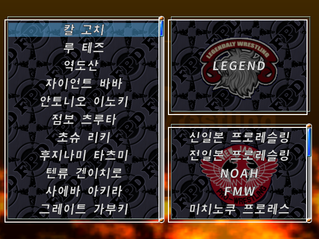
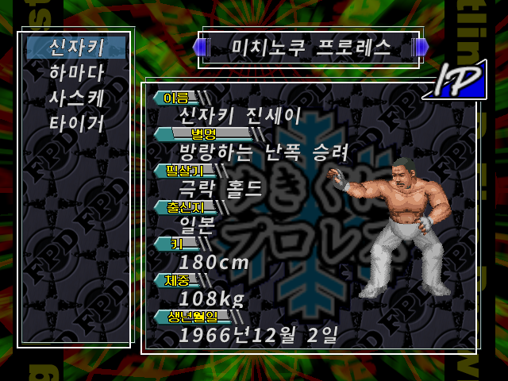
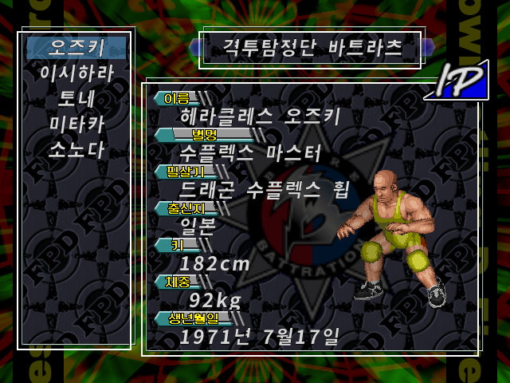
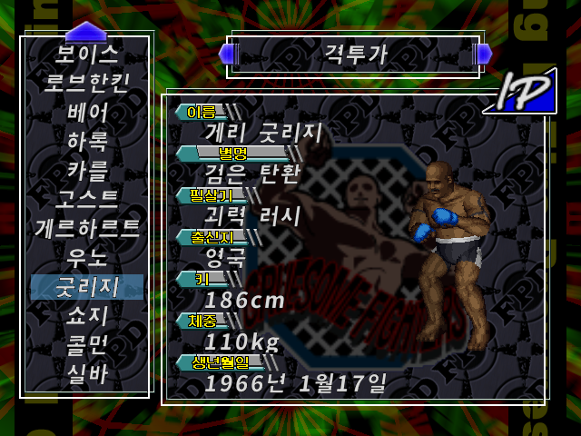
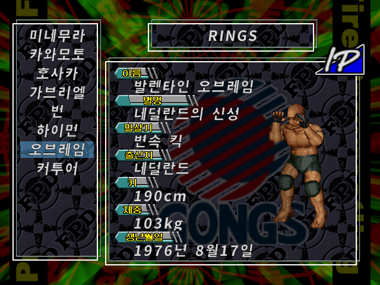
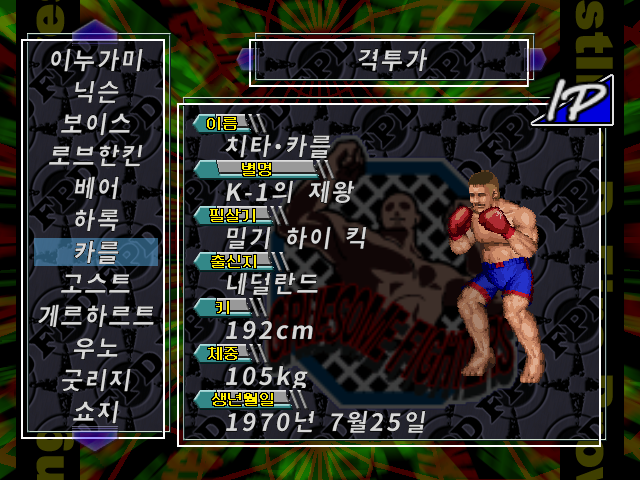
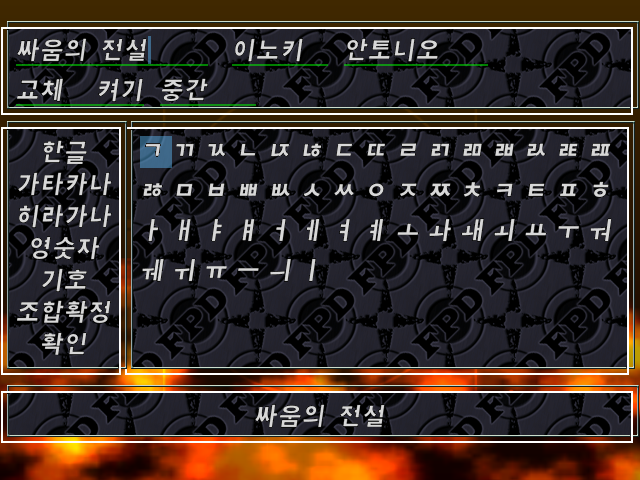
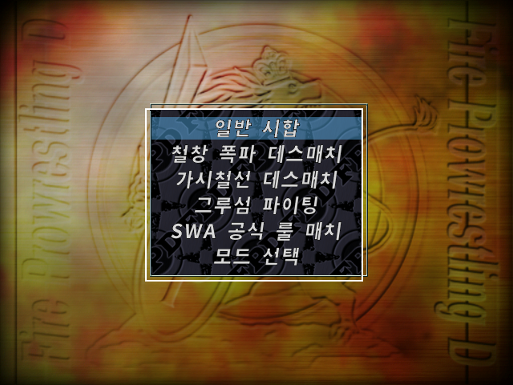

# v0.91 피드백 반영 및 실행 검수

2026-11-18 검수. 단체 14곳의 정식 이름·약칭과 관련 세력/별명 텍스트, S-1 표기, 추가 선수 7명의 이름을 교정했습니다. 번역 카탈로그의 변경 행은 총 77개입니다.

## 단체명 전체 변경

| 기존 명칭 | v0.91 표시명 | 좁은 칸 약칭 |
|---|---|---|
| VIEW JAPAN | 신일본 프로레슬링 | 신일본 |
| OLIVE JAPAN | 전일본 프로레슬링 | 전일본 |
| SUPER NOVA | NOAH | NOAH |
| 신생 IW | FMW | FMW |
| 유키구니 프로레슬링 | 미치노쿠 프로레스 | 미치노쿠 |
| 초룡관 | 투용문 | 투용문 |
| ZIP JAPAN | 대일본 프로레스 | 대일본 |
| 간사이 프로레슬링 | 오사카 프로레스 | 오사카 |
| WFW | WWF | WWF |
| WWC | WCW | WCW |
| THREE-A | AAA | AAA |
| 공스 | RINGS | RINGS |
| 하이클래스 | 판크라스 | 판크라스 |
| 배틀레이션 | 격투탐정단 바트라츠 | 바트라츠 |

단체 ID와 소속은 그대로입니다. 단체 선택·단체 이적·단체 편집 등 텍스트 이름을 바꾸며, **원작 엠블럼 그림은 그대로**입니다. `미치노쿠 프로레스`, `격투탐정단 바트라츠`는 요청한 표기를 적용했습니다.

## 다운로드 추가 선수 7명

| 다운로드 팩/슬롯 | v0.901 표시명 | v0.91 표시명 | 실제 선수 영문 |
|---|---|---|---|
| SPIKE1_4:5 | 히노 마사루 | 우노 카오루 | Kaoru Uno |
| SPIKE1_4:6 | 굴리 배드에지 | 게리 굿리지 | Gary Goodridge |
| SPIKE2_4:0 | 야마지 아키라 | 쇼지 아키라 | Akira Shoji |
| SPIKE2_4:1 | 마이크 올맨 | 마크 콜먼 | Mark Coleman |
| SPIKE2_4:5 | 발렌티노 오프라인 | 발렌타인 오브레임 | Valentijn Overeem |
| SPIKE2_4:6 | 감마레이 다 실바 | 반델라이 실바 | Wanderlei Silva |
| SPIKE2_4:7 | 앤디 쿠버 | 랜디 커투어 | Randy Couture |

이름 필드와 성/이름 순서·반각 구분자를 교정했습니다. 외형·능력·기술·CPU 로직·소속은 유지합니다. `굿` 글리프를 두 서체에 추가했고, 기존 글리프·한글 조합 모양·24px 글자 크기는 유지했습니다. 추가 선수 이름 교정은 누적 43명(실존 선수 41명, VF 게스트 1명, 마스코트 1명)입니다. 미확정 편집 캐릭터 2명과 기존 슈트 계열 1명은 그대로입니다.

## 관련 문구

S-1 소속 두 곳과 `S1의 제왕` 별명을 `K-1`, `K-1의 제왕`으로 교정했습니다. 본편 기술명 두 곳과 SPIKE7:4의 필살기명에 남은 유키구니 표기를 미치노쿠로 통일했습니다. 기술 동작 자체는 바꾸지 않았습니다.

## 느려졌던 구간 재검사

| 검사 구간 | 첫 이동 | 계속 누른 뒤 반복 이동 | 측정 범위 |
|---|---|---|---|
| 단체 이적 선수 목록 | 1프레임 | 5~6프레임 | 180 VBlank / 34회 이동 |
| 격투가 선수 선택 | 2프레임 | 8~9프레임 | 90 VBlank |
| 한글·가타카나·히라가나·영숫자·기호 입력 | 각 1프레임 | 각 4프레임 | 5개 문자판 각각 20 VBlank |

같은 v0.91 이미지에서 컨트롤러 입력 후 실제 선택 인덱스/프로필 변화를 매 VBlank 읽었습니다. 게임 메모리에 쓰지 않았습니다. 표의 프레임은 에뮬레이터의 VBlank 기준이며 실물 기기 FPS나 모든 메뉴의 성능을 뜻하지 않습니다. 단체 이적은 과거 수정 전 반복 108프레임 지연이 있었던 선수 목록을 다시 확인했습니다. 이번 변경에서 입력·글꼴 캐시 코드는 0.901과 바이트 동일합니다.

## 레트로아크 실행

RetroArch 1.22.2 + Flycast에서 **배포 EXE로 원본 GDI에 적용한 결과**를 BIOS 부팅했습니다. 새 설정·세이브스테이트 없음·OpenGL Core·스레드 렌더링 켜기 조건으로 6,000프레임 실행 후 일반 시합 메뉴를 확인했고 종료 코드 0, 시간 초과 없음이었습니다. 0.901의 마지막 데이터 트랙 부팅 배치를 유지합니다. 이번에 모든 OS/코어/그래픽 옵션을 다시 전수 검사한 것은 아닙니다. [환경·해시와 과거 부팅 수정](RETROARCH.md).

## 실제 화면

### 단체 이적: 실제 단체명

### 미치노쿠 프로레스

### 격투탐정단 바트라츠

### 게리 굿리지

### 발렌타인 오브레임

### K-1의 제왕

### 한글 입력 문자판

### 레트로아크 BIOS 부팅 후 일반 시합 메뉴

## 데이터와 검수 기록

0.901 대비 변경된 게임 파일은 `1ST_READ.BIN`, `SBL.BIN` 두 개입니다. SBL의 변경 항목은 1·2(문구), 254·255(글꼴), 370(추가 선수 이름)뿐입니다. 경기 코드·조합 입력 코드·이미지·애니메이션·DLC 기술 100개 동작·선수의 능력/외형 바이트를 대조했습니다. 원본 대조 압축 스트림 243개, UI 폭 조건 2,237개, 테스트 63개, 실제 EXE의 CHD/GDI 양방향 적용과 실패 처리 9사례를 통과했습니다. 실물 드림캐스트 테스트는 하지 않았습니다.

[검수 요약](VERIFICATION.md) · [실제 화면 검사](feedback-runtime.json) · [바이트 변경 범위](feedback-delta.json) · [카탈로그 변경 77행](feedback-changes.json)

참고: 사용자 피드백과 보관 원본 DLC 대응표를 대조했습니다. 단체 표기는 [미치노쿠 공식](https://michipro.jp/), [판크라스 공식](https://www.pancrase.co.jp/), [국립국회도서관 바트라츠 표목](https://id.ndl.go.jp/auth/ndlna/00838181)을 참고했습니다. 우노는 [UFC 역사 자료](https://www.ufc.com/news/fight-flashback-first-event), 콜먼은 [UFC 명예의 전당](https://www.ufc.com/hof/mark-coleman-hall-of-fame), 커투어는 [UFC 선수 자료](https://www.ufc.com/athlete/randy-couture)에서 영문 표기를 대조했습니다.
