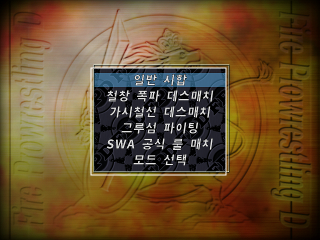
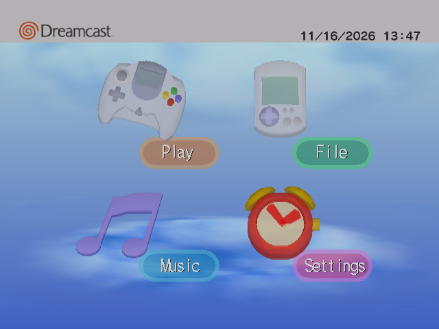
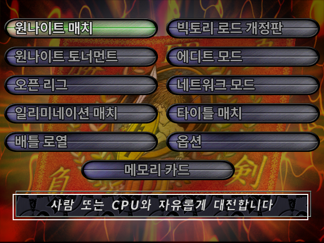
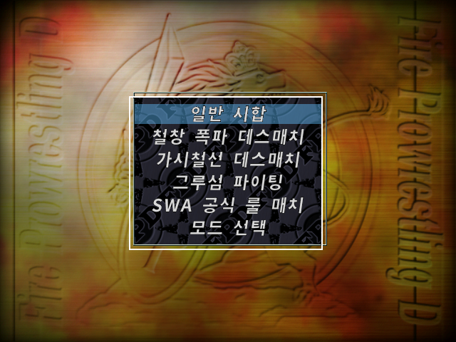

# 0.91 실행 재검수

2026-11-18: 실제 0.91 배포 EXE의 원본 GDI 적용 결과로 BIOS 부팅 및 일반 시합 메뉴 진입을 다시 확인했습니다. RetroArch 1.22.2 + 같은 Flycast 코어, OpenGL Core, 스레드 렌더링 켜기, 새 설정, 세이브스테이트 없음, 6,000프레임 실행입니다. 종료 코드 0이며 시간 초과가 없었습니다. [검사 환경과 실행 파일/코어 SHA-256](retroarch-v091-verification.json).

아래는 0.901 당시의 원인 분석과 추가 환경 검사 기록입니다. 0.91에서는 그 부팅 배치를 유지하고 단체/선수명 텍스트를 갱신했습니다. 아래의 “내용 동일”은 **0.9와 0.901 사이**의 비교를 뜻합니다.

# 0.901 레트로아크 BIOS 부팅 수정

v0.9 패치 GDI가 Flycast의 실제 BIOS 부팅에서 게임 대신 본체 메뉴로 돌아가는 문제를 재현했습니다.
같은 레트로아크·코어·BIOS에서 일본판 원본은 게임으로 진입했습니다. HLE 부팅만 확인했던 검수로는 이 차이를 잡지 못했습니다.

v0.9는 확장 SBL 데이터와 겹치는 실행 파일을 3번 데이터 트랙의 빈 공간으로 옮겼습니다.
0.901에서는 실행 파일을 마지막 데이터 트랙(50번)에 배치합니다. 자리를 마련하기 위해 브라우저 사운드 뱅크 한 파일을 3번 트랙의 빈 공간으로 옮깁니다.
두 파일의 내용과 크기는 그대로이고 ISO 디렉터리의 위치 정보, 새 위치의 데이터와 EDC/ECC를 갱신했습니다.
검사한 Flycast에서 이 배치 변경으로 BIOS 부팅과 메뉴 조작이 정상화됐습니다.

| 파일 | v0.9 LBA | 0.901 LBA | 내용 |
|---|---|---|---|
| 1ST_READ.BIN | 45040 | 501830 | 바이트 동일 |
| DPETC/DP3SOUND.MLT | 501830 | 45040 | 바이트 동일 |

전체 게임 파일 51개의 내용이 v0.9와 동일합니다. 번역·글꼴·이미지·선수·DLC·게임 코드를 바꾸지 않았습니다.
원본 50트랙 구조, 오디오 47개, IP.BIN을 보존합니다. 빌드 과정에 자동 배치 수정과 마지막 데이터 트랙의 부팅 파일 검사도 넣었습니다.

## 실제 레트로아크 실행 검사

Windows x64, RetroArch 1.22.2(`69a4f0e`), Libretro 공식 빌드봇의 Flycast를 사용했습니다.
셰이더·세이브스테이트·기존 설정을 사용하지 않는 별도 폴더에서 새로 부팅했고 컨트롤러 START 입력으로 메뉴를 진행했습니다.
BIOS MD5는 `e10c53c2f8b90bab96ead2d368858623`입니다. BIOS는 배포하지 않습니다.

| 입력 | 부팅 | 그래픽 | 확인 결과 |
|---|---|---|---|
| 일본판 원본 GDI | BIOS 사용 | OpenGL Core | 게임 인트로 |
| v0.9 GDI | BIOS 사용 | OpenGL Core | 본체 메뉴로 복귀: 실패 |
| 0.901과 동일한 수정 GDI | BIOS 사용 | OpenGL Core | 한글 메인 메뉴 |
| 0.901 GDI | HLE 사용 | OpenGL Core | 한글 경기 규칙 메뉴 |
| 0.901 GDI | BIOS 사용 | Direct3D 11 | 한글 경기 규칙 메뉴 |
| 0.901과 동일한 수정 CHD | BIOS 사용 | OpenGL Core | 한글 경기 규칙 메뉴 |

CHD는 수정 GDI에서 CD Deflate/CD FLAC으로 만든 시험용 파일입니다. 다시 50트랙으로 추출해 모두 동일한 해시임을 확인했습니다.
원본과 결과는 읽기 전용으로 비교하며 실행 중 게임 메모리나 코어를 수정하지 않았습니다.

### v0.9에서 재현한 실패

### 수정 GDI의 BIOS 부팅

### 변환 CHD의 BIOS 부팅과 메뉴 조작

## 적용

0.901 EXE로 **패치 전 일본판 원본 CHD 또는 GDI에 다시 적용**하세요. v0.9 결과에 덧씌우는 패처가 아닙니다.
새로 만든 GDI와 트랙 50개를 함께 사용하고 이전 빌드의 세이브스테이트 대신 새로 부팅하세요.
HLE 켜기를 필수 해결책으로 요구하지 않으며 BIOS 부팅에서도 검사했습니다.

배포 EXE의 CHD/GDI 양쪽 적용 결과 50트랙, 한글·공백 경로, 실패 9사례와 원본 보존을 확인했습니다.
테스트 63개와 원본 대조 5단계·압축 스트림 243개 검사를 통과했습니다.
검사 기록: [레트로아크](retroarch-verification.json), [패처](patcher-verification.json).

다른 OS/코어 버전·모든 그래픽 옵션·모든 게임 장면의 전수 검사와 실물 드림캐스트 시험은 포함하지 않습니다.
Flycast의 GDI/CHD·BIOS 지원 설명: [Libretro 공식 문서](https://docs.libretro.com/library/flycast/).
